# Work markers

This document is the SSOT for the rules governing the work-marker emojis that I want mockup projection engine to generate; each emoji's own row (its meaning, its predicate and its history) lives in `source/lawyer/mcp/src/submission/forms/symbol-table.ts`, the single source for the rows. Every marker whose predicate holds renders immediately after its component. While this is the canonical document and most definitive record of my intentions for the /draft skill, it is also a work in progress and remains open for discussion with me when problems are found, or when new features/functionality are being added.  No changes to this document may be made without discussion with and express approval from both me and a Fable agent.

## Reading rules

A marker is a **to-do on that line**, never a status label. (1) Each **work** marker names remaining work; work markers are distinct when different work finishes them — **event** markers are distinct by the state they report, and several events may route the same work (🙅🏻‍♂️ 🫸 🤷 → 👤). (2) Deferred work is still work (🂡 🤥). (3) Only ⬜ means nothing started, nothing decided. (4) A marker clears only when its work finishes, not at a step toward it; an event clears when the work it routed begins (🤫 excepted: §1 → Suppressed). (5) An emoji naming no work (a place or label) is struck — so died the old ⚖️ *authority slot*. (6) A clean line = no marker.

**Connectives** (∥ and bare `/` retired): ∨ inclusive or (💬 ∨ 🧷) · ⊕ exclusive, chain reads exclusive (⏰⊕🤝⊕🙅🏻‍♂️⊕🫸⊕🤷) · ∧ or juxtaposition = both (💬🧷). Exclusivity is **per object** — ⚠️⊕🚨⊕⛔ per authority yet ∨ per rendered line (an order's line can carry two authorities' different treatments, one per jurisdictional edge); gaps emojis ⊕ per gaps row, ∨ per line. Write the connective for the scope discussed, naming it when not obvious.

**Types** — who does the verb, when. **work** (1a): us; the act or thing to supply; renders alone after the component. **event** (1b): them or the world; the event itself — the outcome is the information; never alone: prefix of the work emoji it routed (⏰→📑📌🕹️ on a notice to admit, 🙅🏻‍♂️→👤, ⛔→🏛️⊕📖), clearing when that work begins; a **bare** event emoji = the routing decision is the work. **hold** (1c): us; the posture; printed on no mockup and no filed face. Applying the work-first standard to an event emoji is a **type error**. One event is counsel's own act rather than theirs or the world's: 🤫 *suppressed* prints in place of the work it sets aside, not as its prefix, and clears as §1 → Suppressed says.

**Mis-readings:** "state, not work" (old ⚖️ — rule 5) · "reserved = no work" (rule 2) · "never reaches a document" ≠ hide-from-mockup — a mockup **is** a document; render for the human, withhold from the forum (CLAUDE.md).

## 1. Emojis

**Killed binds every row of §1.** A killed item's own lines — the submission's, the authority's, and each of that authority's statements' — render no marker of any of the three types below (1a–1c), work, event or hold (§4). A row that names `killed_on` restates this or reads across statements (§4 (i)) — both are wanted, neither is redundant; a row silent on it is not a carve-out. Killing an item silences its own lines; markers that read across the item fire as if it were gone — 🏛️ ∨ 🦵 on the order's line, 📖 🔬 🥉 🥈 🏅 on the proposition's line (§4).

**Overruled binds every row of 1a.** An authority whose `treatment` is `'overruled'` is not good law, so its own lines and its statements' own lines render no work marker: 📜 📍 🔬 🏅 🧐 are all withheld, on rule 1 — nobody is asked to excerpt, locate, scrutinize or rate an authority the court has rejected, and 📇 is spent (on a case, its outcome is how the treatment is known). ⛔ itself still renders. Where a jurisdictional statement's ladder would print on the order's line, an overruled one contributes ⛔ 🏛️ alone — the order's line is not the authority's own line, and the basis it was to supply reads as needed again. The statement filling each of the order's jurisdictional edges, and its authority's treatment, are part of the order snapshot (review.md), so 🧐 holds behind 🏛️ while the overruled authority stands and rises again once it is replaced, the review confirming that the order rests on its new basis. The proposition's line is not the authority's own line either, and takes the doctrinal twin of that rule: an overruled authority's statements count toward nothing read across statements, so 📖 🔬 🥉 🥈 🏅 fire as if they did not exist, and a proposition left with no counted statement reads ⛔ 📖, the event prefixing the basis it reopened (Types), unless 🚧 owns the line. A proposition that keeps a counted statement carries ⛔ on its own line too, beside 🧐 where 🧐 fires, until counsel approves it: its overruled statement prints on no mockup (§4), so the proposition's line is where a delivery mockup asks counsel to confirm the overruling, and once approved the bare ⛔ names the routing decision left (Types). Wherever ⛔ prints on the proposition's line (with 🔬 or the rung, beside 🧐, bare once approved, or as ⛔ 📖; never under 🚧, which prints no ⛔), a plain-text tag `(overruled: <style of cause>, <citation>)` immediately before it names each overruled, non-killed authority once (the citation omitted where none is recorded, several joined by `; `), so counsel can confirm the overruling. Like `(killed <date>)` it is text, not a glyph: rendered for the human on every mockup, stripped from every filed or sent face. The overruled statement's own line carries ⛔ as well. On the statement's own line 👃 still renders beside ⛔: it reads `doubt` on the statement, never the treatment column (§4 → 👃 stage), so the treatment spends nothing of it. That is the difference from a killed authority, which silences every type including its own ⛔. A 1a row silent on `treatment` is not a carve-out.

**Failed binds every read across statements.** A statement of law whose `verification` is `'failed'` (v46) is one the research lawyer scrutinized and returned as not supporting its proposition — fit or ratio or both. The return finishes 🔬 (rule 4), so the statement's own line renders no 🔬; its finding is written into `doubt` (a failed statement always has one — CHECK) and renders as 👃, whose work on this instance is the statement's scrutiny review job (v47), the practitioner's: a change, a keep over the finding, or a drop, closed only on counsel's confirmation — never a re-dispatch, the noting-up sweep included. Unlike killed and overruled, nothing else on its own line is silenced: the authority is not rejected, only this use of it, so 📜 📍 🏅 📇 render as they would on a lead, and 📇 on that line generates nothing, as on a lead. Across statements it counts as none, like a killed or overruled authority's statements: 📖 🔬 🥉 🥈 🏅 on the proposition's line and 🏛️ on the order's line fire as if it did not exist, so a proposition or basis it alone supplied reads 📖 or 🏛️ again. While any statement of a proposition is `'failed'`, that proposition's 📖 renders but generates no Proposal: the next step is the practitioner's decision, not new research. It rides the brief-only cap with leads: printed only on a prose-cited statement's mockup-only line, never on a filed or sent face. Its citation is tagged `(scrutiny failed: <finding>)` in plain text, and the same tag prints on its proposition's line and on any implied clause line citing it, so no line resting on it reads clean — rendered for the human, withheld from the forum, text not a glyph (rule 5). A failed row is never reset by an edit (v47): rewording its proposition, re-pointing it or re-capturing its excerpt leaves it `'failed'`; only the confirmation write moves it (§1 → Settled) — a drop writes nothing to it, and a kill silences its lines (§4) without changing the value. A row silent on `'failed'` is not a carve-out.

**Settled reads as verified on every row.** A statement of law whose `verification` is `'settled'` (v47) is one counsel closed over a failed finding, after its review job showed the finding, the statement as it failed and as it will stand, and, where the authority, pinpoint or excerpt changed, the authority's own text at the new pinpoint with the word-level diff of the excerpt. It counts as support like `'verified'` on every read across statements: 📖 🔬 🥉 🥈 🏅 on the proposition's line and 🏛️ on the order's line read it as they read a verified statement. It prints on the filed face. That is deliberate, not unverified material reaching the forum: counsel has read the finding and the source and confirmed the statement over it, which is counsel's call to make, so a settled row is never withheld from a filed face. It never reads as verified by the research lawyer: its citation carries a plain-text `(settled by counsel <date> over scrutiny finding)` tag on every mockup line it prints on, stripped from the filed face (rule 5 — text, not a glyph), and its own line carries no 🔬 and no 👃 at all: `doubt` holds the finding as the record (CHECK), and the row raises none while settled. Every other marker renders as on a verified row, 📇 included. One trigger reopens it: when its `authority_id`, `pinpoint` or `excerpt` moves off the snapshot taken at the close, it returns to `'lead'`, 🔬 derives once for the new pair, and the kept finding renders as 👃 again; the same trigger reopens a verified row whose pair moves off its snapshot. A proposition's wording reopens neither. A row silent on `'settled'` is not a carve-out.

**Fit tells rate nothing** (v61, `Engineering/1. Design/2026-10-06_authority-fit-checks-spec.md`). Two cheap checks of a statement of law's fit to its proposition render on the mockup for the human and are withheld from the forum. Neither is a rating, and neither sets `weight` or `treatment`. (i) A statement whose `excerpt_speaker` is set carries a plain-text `(quoting <source>)` tag on its citation line, right after the pinpoint: the excerpt is words the judgment quotes, not the court's own. It is a value, not a marker (§6), it names no work, and the filed-face strip removes it, since a verified statement prints on the filed face. (ii) 🕰️ *predates the provision*, an event (1b), marks a case's statement when another statement of the same proposition cites a provision dated from a later year than the case was decided: the provision's recorded in-force date, else the year in its citation. It renders beside 🧐 and holds nothing back (§4). It clears when the case is replaced or killed, or when a recorded year changes on either side; after counsel's approval it stays as a bare event, the routing decision made, as ⚠️ does. It is not part of the statement snapshot (review.md), so one first raised after approval renders bare until the next edit re-raises 🧐. Killed and overruled silence it as they silence every row (§1 → Killed, Overruled).

**Suppressed stands in for the work counsel set aside** (v69, practitioner, 2026-10-08). 🤫 is an event (1b): counsel's recorded decision, in their own words and dated, to set aside one work marker the plugin lets nobody waive, on one line. For now that is only the fact-side 👤, one per fact, flat across parties as 👤 renders. It prints **in place of** the marker it replaces rather than prefixing it, keeping any spent rung that prefixed 👤 (🫸 🤫). Read it on rule 2, not rule 5: the work is set aside, not finished and not gone. The predicate still derives the marker, the Legend names the marker 🤫 replaces, and an HTML page shows it on hover. Its criterion counts the item met and lists it as suppressed. It clears when counsel unsuppresses it or the line's wording changes (the database deletes the record). While the marker's own work is finished the line shows neither, but the record stays, so a fact that gains proof and later loses it shows 🤫 again. It never comes from the session's inference, a deadline or time pressure, or an unattended run (filing-checklists.md §6). Like every marker it is rendered for the human and withheld from the forum. Not being work (1a), it leaves 🧐 free to rise on the line.

### 1a. Work emojis — 31

The 31 work rows live in `source/lawyer/mcp/src/submission/forms/symbol-table.ts`, one row per symbol: name, meaning, the work and who does it, `condition` (the predicate) and `history` (the schema record). That file is the single source.

### 1b. Event emojis — 14

The 14 event rows live in `source/lawyer/mcp/src/submission/forms/symbol-table.ts`, one row per symbol: name, meaning, the work the event routes and who does it, `condition` (the predicate) and `history` (the schema record). That file is the single source.

### 1c. Hold emojis — 3

The 3 hold rows live in `source/lawyer/mcp/src/submission/forms/symbol-table.ts`, one row per symbol: name, meaning, the work and who does it, and `condition` (the predicate; a hold has no `history`). That file is the single source.

Crossed out is **not** a hold emoji — strikethrough styling is its rendering (terms-and-symbols → Deployment).

**Unmarked live values** (falsely read finished, rule 6): `gaps.kind='authority'`/`'source'` — every gaps row is work; a marker claims each, or drop (open v3 question) · `sworn_status` — column struck v3.

## 2. Seams

Seams evident from table 1 omitted; a pair not listed here is decided by its own table-1 predicate cells, not by this section.

**Unless-admitted guard — per party.** The guard is: admitted by this party (the derived per-party state 🤝 ⏰ 🕹️ ✅, ADR-0006) ∨ `facts.court_record` set. An admission silences evidence work only **as against the admitting party** — an admission by A never silences proof against B; the court-record branch silences against **all** parties (the one non-per-party silence). Silenced: 👤 (own gate) 🗣️ ✍️ 🖋️ ✒️, (💬 ⊕ 📑) ∨ 📌 ∨ 🧷 on statements of fact, the fact-side 🚧 terminal, and — via a guard inside their predicates — 🎾 ⏳ 🙅🏻‍♂️ 🫸 🤷 (an admission can land mid-Notice; never demand a moot one). Not silenced: (📑 ∨ 📌) ⊕ (💬 ∨ 🧷) on the admission instrument and its response, the pair set by `method`, and 📌 on the court-record link — every proof path ends at a pinpoint.

**Every route runs the ladder.** The pleading route runs 🎾 ⏳ like any route — our pleading is the admission instrument; only oral rows are born answered (🎾 ⏳ never apply).

**A marker's own machinery is never duplicated as a `gaps` row** (👤 🏆 🚧 ⏰ 🤝 derive work from their own columns; a duplicate row = two markers, one job): never a gaps row for what 👤 derives, for 🚧's reframe/drop/proceed decision, or for copy choice (⬜ unpicked; 🏆 decided, maybe wrong). New emojis inherit this rule.

- 👃 vs ↩️ — check theirs / answer theirs; can co-hold on different objects
- 👃 vs 📇 — doubt (either domain, any stage) / routine noting-up workflow; 📇 is not doubt
- ⏳ vs 🖋️⊕✒️⊕↩️ — only ⏳ waits; **practitioners do not wait on themselves** (✒️ unsworn affidavit, ↩️ unwritten reply, never ⏳)
- ↩️ vs 🤝 — answer their assertion / record their admission; a bare denial is neither: 🙅🏻‍♂️, opens no `opposing_points` row
- 🙅🏻‍♂️ vs 🚧 — refused, still provable: build evidence / investigated, nothing found: decide. **Never render 🚧 on a denial**
- 🚧 vs 👤 — investigated, found nobody: decide (reframe / drop / proceed) / not yet looked: keep looking
- 🖋️⊕✒️ vs 💬 ⊕ 📑 / vs 🏆 — different objects/axes, both render; signing raises "best", so clearing 🖋️/✒️ often clears 🏆 (either holds alone)
- 📖 vs 🔬 — nothing counted: research / a lead in hand: scrutinize it; exclusive per proposition; a failed statement is neither — it counts as none, so a proposition left with only failed statements reads 📖 (§1 → Failed); a settled statement counts as a verified one does (§1 → Settled)
- 🔬 vs 👃 — routine verification of a lead / doubt about any statement, verified, lead or failed; can co-hold; a failed scrutiny ends 🔬 and seats its finding under 👃, whose work there is the statement's review job (§1 → Failed); a settled statement keeps the finding and raises neither (§1 → Settled)
- 📍 vs 📌 vs 🧷 — locator into an authority / a document / the witness's instrument; ⊕ per locator, ∨ per line: an exhibit-backed statement of fact can owe 📌 and 🧷 at once (*Affidavit #1 of A. Marlowe, para 3, Ex. A, s. 2.3*)
- 🚩 vs ↩️ — ours-predicted, no served document / theirs-said, a served document, unanswered; when the prediction materializes, open the `opposing_points` row and delete the spent `anticipated_points` row — anticipation spent, no link kept, ordinary CRUD

## 3. Symmetries

↩️ 👃 🏷️ attach identically to statements of fact and of law — same emoji, same work (👃's *trigger* differs: fact-side doubt, law-side doubt; 📇 carries the routine noting-up). The excerpt and pinpoint markers split by basis — 📜 and 📍 authority · 📑 and 📌 exhibit (and a Notice to Admit or pleading answer; 📌 also a court record's locator, owed again when it cites an exhibit the sworn record may not hold) · 💬 and 🧷 testimony (and an interrogatory answer or examination transcript) — so a collapsed Work Board card shows at a glance which kind of source the work needs; each pairs with ↩️ 👃 🏷️ the same way. Vocabulary — three columns (terms-and-symbols → The square): **postulate / proposition / contention** for our claim — *contention* = law applied to fact, the position one side argues for; *argument* = its support, the postulates it rests on + the propositions it requires; *submission* = one contention with its argument — and **statement of fact / of law** for what supports an assertion; `facts.postulate` ↔ law `proposition`; `statements_of_fact` ↔ statements of law. The source ladders are **not** twins (practitioner, 2026-09-20, #718): fact-side **Transmission** (👀 ⊕ ℹ️, untracked today) has no law-side rung, and law-side **Class** (🥇 ⊕ 🥈 ⊕ 🥉 ; ∅ ⇒ 🏅 — read off `authority.kind`) has no fact-side rung; they run in **opposite directions** — a later case citing an earlier one for the same principle is 🥇 and the stronger for it, a witness relaying another's account is ℹ️ and the weaker for it. **Inference** (direct ⊕ circumstantial ↔ on-point ⊕ analogous) is the one shared reliability axis, untracked either side. Vocabulary never crosses: *primary / secondary / tertiary authority* law-side, *direct / circumstantial / hearsay evidence* fact-side; *direct* is the inference word, the transmission word is *personal knowledge* 👀. Tier-3 lead :: 🖋️⊕✒️ — 🔬 is the law-side rung on the Execution axis (`statement.verification` lead ↔ an unexecuted instrument) (terms-and-symbols → Axes).

## 4. Relationships

- **Exclusive:** 🤥 ⊂ 🂡 by posture, not storage (since v10 🤥 reads `purpose` alone; 🂡 is derived) — the specific replaces the general. 🏛️ vs 📖 no longer share a slot to be exclusive over: separate tables since #302, and they never share a line — 🏛️ renders on the order's own line (PART 1), 📖 on the proposition's own line (PART 3).
- **Reserve orthogonal:** derived, never stored — 🂡⊕🤥 co-occur with any marker (🗒️ ∨ 🂡 ruling, generalised); no page prints them. Reserved items (deployed by no document of the filing; for an order, submission or rhetorical paragraph, of any filing of the proceeding — #959, v71) and lead or failed statements (`statement.verification` `'lead'` ⊕ `'failed'`) print on no mockup and no filed face, and their Proposals are still recorded; a settled statement is not among them, and prints as a verified one does (§1 → Settled); the 🔬 a lead raises also renders on its proposition's line in every mockup, never on a filed face. **Crossed out** (`crossed_out_on` set) is the orthogonal pursued axis, not a hold: mockup-only strikethrough, never on a delivered face, never a marker (rule 5). The #367 court-form inline-crossed-out exception is superseded — reserve and crossing out are now separate acts on separate axes (terms-and-symbols → Deployment).
- **Killed — subset of reserve by construction, not a hold:** `killed_on` set on a submission removes its pointers, so it is reserved; on an authority, its statements ride the brief-only cap as lead statements do — printed on no mockup. Two consequences. (i) A killed authority's statements count toward nothing read across statements: 📖 🔬 🥉 🥈 🏅 on the proposition's line and 🏛️ on the order's line fire as if those statements did not exist, so a basis they once filled reads as needed again. (ii) A killed item's own lines — the submission's, the authority's, and, for an authority, each of its statements' — render no 🂡 and no marker of any type, work, event or hold: the decision 🂡 names has been made, and nobody is asked to excerpt, locate, scrutinize, rate or note up an authority the practitioner rejected (rule 1: a marker names remaining work). Where a jurisdictional statement's ladder would print on the order's line, a killed one contributes 🏛️ alone. A statement line that cites it, such as an implied clause's, carries `(killed <date>)` in plain text so the clean line is not read as finished (rule 6; rule 5 — text, not a marker; terms-and-symbols → Rendering). Kept only so no later session re-proposes it (terms-and-symbols → Deployment).
- **Overruled rides the cap:** an authority whose `treatment` is `'overruled'` keeps its statements of law, and they ride the brief-only cap as a killed authority's do (§4 → Killed) — printed on no venue mockup and no filed face — so an authority the court has rejected is never quoted to a forum (#842). Unlike killed, nothing else changes: `killed_on` stays ∅, no pointer moves, and the authority's own lines still carry ⛔ (§1 → Overruled), so the statement's ⛔ is the tell that the `(killed <date>)` tag supplies for a killed statement (rule 6; terms-and-symbols → Rendering).
- **Adverse orthogonal:** 🚩 is independent of 🂡 — not a subset like 🤥, and reads no deployment state at all (`anticipated_points` sits outside the deployment axis entirely; a `facts.adverse` flag is silent to deployment). A fact can be deployed — even disclosed — and still carry 🚩; both render when both hold, same co-occurrence rule as 🂡⊕🤥 (#390).
- **Fit tells orthogonal:** 🕰️ is an event and the `(quoting <source>)` tag is text, so neither holds back 🧐 nor joins a ladder (§5). Both render beside whatever else the statement's line carries, as ⚠️ does, and counsel weighs them in the review. Reuse in a new draft or answer shows the statement's provenance line, and offers `/verify-law` Mode A where either tell is present (`scrutiny.md` → Read a statement's provenance).
- **👃 stage:** stage-independent doubt on both sides, seated on the statement (`doubt`), never the assertion; a failed scrutiny's finding is seated there too (§1 → Failed), and stays there on a settled statement, which raises no 👃 while settled (§1 → Settled). The law side is no longer "a rung after 📍" — 📇 is that rung: 📖 → 📜 → 📍 → 🔬 → 📇 → 🧐 → clean; on a case its outcome fills the treatment column (⚠️⊕🚨⊕⛔⊕good law); on a statute, regulation or rule it clears when `currency_status` reads `'current'`, and an authority of kind doctrine raises none (shared/statute-currency.md → Noting up legislation).
- **Parallel routes:** admission and evidence branches on one fact run concurrently; markers from both render. The guard is per party (§2), not a branch switch.
- **Gaps:** 🧩 🏷️ 🕵️ ⬜ share one `gaps` row — `kind` one value, exclusion **data-enforced** per row; several rows per entity → two can render on one line.

## 5. Lifecycles

At most one rung per object; different lifecycles/tracks stack. **Forks** are **per moment, not per object** — a rung resolves into the next entry (a resolved 🕵️ becomes a fact, a 🧩, or nothing: rewrite the gaps row). Entry: fact 🕵️⊕🧩⊕↩️, law 🏛️ (order's own ladder) ∨ 📖 (proposition's own ladder) — independent, not a one-hot pair (§4). Exclusivity per object: 🖋️⊕✒️ on the instrument · (💬 ⊕ 📑) ∨ 📌 ∨ 🧷 on the statement of fact (📌 only with an exhibit, 🧷 only with an instrument) · 📖 ⊕ 🔬 on the proposition · 👤 on the fact · later rungs on the evidence beneath; a fact can carry 👤 with no evidence line. 🖋️ ✒️ 🏆 also ride the document row, a parallel stacking track.

**Enforcement:** data-enforced — gaps (`kind` one value), 🗣️ (`interviewed`), admissions (state derived from the row + dates, never stored — ADR-0006); derived — ✍️⊕(🖋️⊕✒️) by instrument link, 📖 🔬 and 🥉⊕🥈⊕🏅 from the statement set; aim-for — one treatment column enforcing 📇→(⚠️⊕🚨⊕⛔⊕good law) on a case, `currency_status` closing it on a statute, regulation or rule; the rest renderer discipline. Co-fires: 📖+📜 and 📖+🔬 resolved by structure — 📖 reads *no counted statement row* (killed, overruled and failed count as none), 📜 and 🔬 read a counted statement row: they cannot co-fire · (🖋️⊕✒️)+🧷 on a null pinpoint → written, unexecuted instrument: 🧷 legitimately co-fires; ✍️ and oral: no instrument, no 🧷 (📌 still fires if an exhibit is set).

**Proof (admission):** entries per method — 🎾 → ⏳ → (🤝⊕🙅🏻‍♂️⊕🫸⊕🤷⊕⏰) [⊕ ⚡️ struck, → ⏳ on a court-reset `response_due`, else → 👤]; ⏰/🤝 → ((📑 ∨ 📌) ⊕ (💬 ∨ 🧷)) ∨ 🕹️ → clean (capture + cite + enter the admission instrument, the pair set by `method`; all must clear; the admissions row is not an object 🧐 attaches to — the postulate it proves still carries 🧐 on its own line by table 1a); 🙅🏻‍♂️ 🫸 🤷 → evidence entry. Pleading: no Response → ⏰ admitted-withdrawable → 🕹️ default-judgment requisition → ✅ judgment entered. **Proof (evidence):** (🕵️⊕🧩⊕↩️) → 👤 → 🗣️ → ✍️ → (🖋️⊕✒️) → (💬 ⊕ 📑) ∨ 📌 ∨ 🧷 → 🧐 → clean. Every path ends at a pinpoint. On a statement of fact, 📑 and 📌 are offered as soon as the exhibit is linked, whether or not 🖋️ or ✒️ still stands on the instrument; 💬 and 🧷 are offered only once the instrument has cleared 🖋️ or ✒️. This orders Work Board offers on a statement of fact, not rendering — a marker still renders whenever its table 1a predicate holds, and the admission clauses carry their rung (🤝 ⊕ ⏰, through 🕹️ and ✅) in the predicate itself. Terminal: 🚧, dead-ending the investigative rungs (#305) — the **only** terminal; a denial is not one.

**Authority support (doctrinal):** 📖 → 📜 → 📍 → 🔬 → 📇 → 🧐 → clean, 📇's outcome filling the treatment column (⚠️⊕🚨⊕⛔⊕good law) on a case (a statute, regulation or rule: §4 → 👃 stage), the return's coverage and qualification filling `treatment_note`, printed as a plain-text `(note-up: …)` tag — ⚠️ ⊕ 🚨 render beside 🧐, and a later change of treatment or of the note re-raises it; ⛔ silences it on the statement's own line and reopens the basis (§1), the proposition's line carrying ⛔ instead, with its `(overruled: …)` tag naming the authority and, while a counted statement survives, 🧐 for the confirmation; 🔬 clears only on the research lawyer's return — `'verified'`, and the ladder goes on to 📇, or `'failed'`, and the statement leaves the ladder's counts, its finding under 👃 for its review job until the confirmation write settles it (§1 → Failed, Settled); a settled statement rejoins the ladder at 📇 as a verified one does, and returns to 🔬 only when its authority, pinpoint or excerpt moves off its snapshot (§1 → Settled); noting up mandatory pre-filing; 🧐 clears only on counsel's approval of the content as it stands. 🥉⊕🥈 sit on the proposition's line after 📖 fills — the best-`source` rung of its statements; 🏅 co-renders there while any of them is unrated, and on each unrated statement's own line. Terminal: 🚧 — researched, nothing found. **Authority support (jurisdictional):** the same ladder since #348 — the edge's `order_sought_requires.excerpt_id` → statements_of_law (`jurisdiction_excerpt_id` at v7; the edge since v10, #380) carries 📜/📍/🔬/📇 and treatment (`currency_status` for a statute, regulation or rule) for the order's citation (renderer reads 📇 for `treatment` ∅ since #363, by authority kind since #1628).

## 6. Not in the set

A blank is deliberate; admitted only when a journey names its reader.

- unserved petitum — **admitted** 2026-08-26 as 🦵 (#380): an order sought that no submission serves; reader is the drafter
- form-vs-WA mismatch — **admitted** 2026-08-26 as 🧵 *loose thread* (#380): the venue form deploys it, the Written Arguments never argues it; derived from the pointer lists, render shipped #384
- contention with no factual basis — **admitted** 2026-08-27 as 🧾 (#373): a submission no stated fact supports, and no recorded no-facts-needed decision for the current wording (v48); reader is the drafter, on the submission's first rendered paragraph (moved off the contention line 2026-08-31 when the contention sentence stopped rendering at all; moved back onto it 2026-09-01 when that sentence was restored as the argument's opening numbered paragraph)
- contention with no legal basis (`submission_law` ∅) — **admitted** 2026-10-06 as 📚 *proposition needed* (application-paragraphs spec, practitioner + Fable): a submission no proposition supports, and no recorded no-law-needed decision for the current wording (v60); reader is the drafter, on the contention line beside 🧾. The journey is the practitioner's *application paragraph*: a contention that links at least one fact and one proposition. The both-∅ no-argument shape is no longer held: it carries 🧾 and 📚, and counsel may record one of the two decisions, never both, since a contention with neither facts nor law is not a submission (terms-and-symbols → submissions). **Ordinary costs exempt** 2026-10-07 (practitioner): a submission that only asks for ordinary costs derives no 📚, by the fixed rule in the `symbol-table.ts` 📚 row; special costs, costs in any event of the cause, a higher scale, solicitor-client, double, lump-sum and costs against a non-party or a lawyer still fire
- adverse fact (harmful to our own position) — **admitted** 2026-08-27 as 🚩 (#373/#390): a fact recorded as true but unfavourable to our side; reader is the practitioner, at application review — disclosure judgment (candour, via `/legal-research`) and rebuttal preparation, never decided by the pipeline itself
- anticipated adverse submission (a point the other side may run against us, not yet raised) — **admitted** 2026-08-27 as 🚩 (#373/#390): the practitioner's own prediction, recorded in `anticipated_points`, distinct from `opposing_point` (which is real, served, and drives ↩️); reader is the practitioner, same posture as the fact-side instance above
- crossed out — **not a marker**: strikethrough styling is its rendering, an emoji here would name a decision made, not work (rule 5; terms-and-symbols → Deployment)
- killed (a submission or authority the practitioner reviewed and rejected) — **admitted 2026-09-06 as a stored axis, not a marker** (`submissions.killed_on`, `authorities.killed_on`, schema v16): an emoji would name a decision made, not work (rule 5, as crossed out). Rendering: none on any mockup (the former brief listed them with the date); reader is the drafting session, which never re-proposes a killed item
- relief sought in the alternative — **struck** 2026-09-22 as an instance of ⬜ (#810/#826): an alternative order is relief the practitioner drafted and seeks, so the glyph named a decision made, not work (rule 5, as *crossed out* and *killed*); it was unconditional, so it could never clear (rule 4), and the line renders clean (rule 6). ⬜ itself is unaffected — its other instances stand. Reverses the requirements-ledger intent (#300, T10b) that the practitioner picks among alternatives on the mockup, whose premise #810 removed
- fact-side dead end — **admitted**: 🚧 widened both sides (#305); fact predicate queued
- admission-route dead end (they refused) — **admitted** 2026-08-19 as 🙅🏻‍♂️; joined 2026-08-22 by 🫸 🤷 (three events, one routed work); none is a terminal, all route to evidence
- 📄 not the best copy — **admitted** as 🥉 (#305), renamed 🏆 2026-08-22 (🥉 re-pointed at *tertiary* / *only tertiary*)
- law-side unverified support (tier-3 lead) — **admitted** 2026-09-12 as 🔬 *scrutinize* (#502): a lead in hand whose fit and ratio are unchecked; reader is the research lawyer. 📖 narrows to *no statement at all*; the lead statement prints on no venue face
- law-side failed scrutiny — **admitted 2026-10-02 as a third `verification` value, not a marker** (`'failed'`, schema v46): a lead the research lawyer returned as not supporting its proposition; no new glyph, since the finding is doubt (terms-and-symbols → Doubt: *misattributed* / *misread*) and renders as 👃 on the statement's own line with a plain-text `(scrutiny failed: …)` tag; the statement counts toward nothing read across statements and rides the brief-only cap; reader is the practitioner, through the statement's scrutiny review job (v47: a change, a keep over the finding, or a drop, each closed only on counsel's confirmation; nothing re-dispatches it). A fit-only re-check and a separate Proposal kind were declined: 🔬 is one act, and the stored finding records which half held
- law-side settled scrutiny — **admitted 2026-10-02 as a fourth `verification` value, not a marker** (`'settled'`, schema v47): counsel's confirmed close over a failed finding at the end of the review job; it counts as support, prints on the filed face by counsel's call, and carries a plain-text `(settled by counsel <date> over scrutiny finding)` tag on the mockup (§1 → Settled); an emoji would name a decision made, not work (rule 5, as killed)
- excerpt quoted from another source (the judgment's words are another court's) — **admitted 2026-10-06 as a stored value, not a marker** (`statements_of_law.excerpt_speaker`, schema v61; authority-fit-checks spec, practitioner): a plain-text `(quoting <source>)` tag on the mockup, withheld from the forum (§1 → Fit tells); an emoji would name a fact about the excerpt, not work (rule 5); it routes no work, since the speaker is known and weighing quoted words is the ordinary review, so it is not an event either; reader is counsel, at review and on reuse
- case decided before its proposition's provision came into force — **admitted 2026-10-06 as 🕰️ *predates the provision*** (event, schema v61; authority-fit-checks spec, practitioner): a year-level comparison, the provision's `provision_currency.in_force_on` first, else its citation's year; it holds back no 🧐, since the routing decision is counsel's in the review, as for ⚠️. The spec's ⏳ was **declined**: that emoji is the admission ladder's *waiting on others*
- non-waivable requirement set aside by counsel — **admitted** 2026-10-08 as 🤫 *suppressed* (event, schema v69; practitioner): a glyph rather than a plain-text tag like v48's no-facts-needed decision, because the requirement still stands and without a glyph the line would read clean (rule 6)
- rhetorical paragraph — **admitted 2026-10-08 as a reviewed paragraph type, not a marker** (schema v71; practitioner): a pool paragraph of persuasion from the record that fits no other type, placed by `filing_rhetoric`; its label `(rhetorical)` and its two advisory tells, `(states law, no authority linked)` (drafter-recorded `states_law` with no law link) and `(states fact beyond its record)` (drafter-recorded `states_fact` with no record or fact link), are plain text, never glyphs (rule 5), stripped from every filed face, and hold no 🧐 back; every link is optional and advisory, so it never clears ↩️ 🧾 or 📚; undeployed it is 🂡, as a submission is; reader is counsel, at review (🧐), for the tells the drafter who recorded `states_law` and `states_fact`
- excerpt by basis — **admitted** 2026-09-12 (#502): 💬 *excerpt needed* split into 📜 authority · 📑 exhibit · 💬 testimony, one Work Board card each
- law-side unrated source — **admitted** 2026-09-19 as 🏅 *unrated* (#597): a statement of law whose `source` is not yet rated; reader is the research lawyer, finishing event that row's rating. Two sites, as 🔬 — the statement's own line, and the proposition's line while the rung is undeterminable. #365 routed ∅ to 🥉 as a fail-visible default; that asserted a falsehood about authority already in hand (an unrated SCC decision, or the governing statute itself, read as *only tertiary*), so 🥉 narrowed to require an actual 🥉 and ∅ took its own marker. Fail-visible is preserved — ∅ still never reads clean — with the falsehood removed
- pinpoint by basis — **admitted** 2026-09-13 (#511): 📍 *pinpoint missing* split into 📍 authority · 📌 exhibit · 🧷 testimony, one Work Board card each, matching the excerpt split (#502)
- final review (content counsel has not approved as it now reads) — **admitted** 2026-09-22 as 📋 *counsel's review* (#859/#861); **re-glyphed and renamed** 2026-09-24 as 🧐 *final review* (practitioner + Fable, 2026-09-24): a board that files AI output as finished teaches the practitioner to scan past it, so the content stays marked until the practitioner reviews it, holistically and last; reader is the practitioner. The predicate never read authorship — wording the practitioner dictates re-raises it too — so the old gloss *AI-finished* was wrong and is dropped. 🧐 was first rejected as reading like suspicion, near 👃; reversed: scrutiny is the intended posture against automation complacency, 🧐 never shares a line with 👃 (its predicate requires that no other 1a marker renders on the line, so on a merged Notice of Application fact line a statement's 👃 holds back the postulate's 🧐 too), and the two share no shape. Nor is it 🔬 *scrutinize*: 🔬 is a 1a marker, so the two never share a line, they route to different actors (research lawyer, practitioner), and they share no shape. 📋 **struck — no return**: it read as a form or a list, in the paper family with 📑 and 📇, and records from 2026-09-22 to 2026-09-24 read 📋 for this marker. Not 👀 — already the fact-side Transmission value *personal knowledge* (§3). Rejected: *Ready for final review* (a status label, rule 1; *Ready* is a Job Board lane) · 🧑‍⚖️ (a joined sequence containing the twice-struck ⚖️, and it reads as the judge, meaning the forum) · 👁️ 👓 (look like 👀) · 🔍 (looks like 🔬) · 📝 🖊️ (the pen family, ✍️ 🖋️ ✒️) · 🖇️ (names no work, rule 5) · the medal family (reserved to the source ladder)
- law-side unknown-relevance lead — **held**: overlaps tier-3 handling
- law-side "known of, not in hand" (:: ✍️) — **held**: overlaps tier-3/sweep-lead; the mirrored ladder skips this rung today
- law-side admission route (law conceded) — **held**: no ladder, emoji, or reader. **Do not extend the admission branch to statements of law**
- 🤝 consent not yet given — **held**: emoji taken 2026-08-19 as *admitted*; consent desk order (#293) needs a fresh emoji
- 📮 unserved party — **held**: a party unserved with the proceeding stays outside the mockup. 📮 itself is now **free** — its *unserved* meaning renamed 🎾 *serve it* 2026-08-22, no return under 📮
- ✅ verified good law — **not a marker**: names no work (rule 5), nothing renders ✅ (rule 6); 🥇 primary likewise a value only — the goal state. Rendering 🥇 as *find a better authority* — **declined** 2026-09-13 (#510): higher, newer, clearer, or shorter authority is practitioner judgment with no finishing event (rule 4) and no clean line (rule 6) — a ticket ⊕ loose thread on the Work Board (ADR 0009), never a marker or a stored request (⏳ requested, below). A binding-upgrade rung (best `source` 🥇 ∧ no `weight='binding'`) — **held**: needs a journey naming its reader and a NULL-`weight` reading. A reminder that an unincluded secondary or tertiary companion authority exists — **declined** 2026-09-19 (#597): the same shape as #510, drafting judgment with no finishing event (rule 4) and no clean line (rule 6); the companion's citation already prints under the proposition, and a decision against including it is `killed_on` (above), not a marker
- ⏳ requested (`slot_state='requested'`, a question to ourselves) — **struck** (#300/#301, T12a/G2), no return; emoji reused 2026-08-19 for *waiting on others* (external party); the v2 value is gone (drift #2 resolved)
- ⚖️ authority slot — **struck** (#305, rule 5), no return; emoji reused 2026-08-19 for *doctrinal basis needed*
- 🏛️ / ⚖️ jurisdictional / doctrinal basis needed — **retired** 2026-08-20 (#312): #302 moved the pair off the shared `argument_authorities.basis_kind` column onto separate tables before this file was updated to match, and the shipped renderer (#297) built against the new columns under new emojis. Table 1a then read 🎖️ and 📖; ⚖️ struck a second time (first as *authority slot*, #305) — no return. **🏛️ returned 2026-09-19 (#597)** to its own former meaning when 🏅 *unrated* joined the source ladder: 🎖️ and 🏅 are both ribboned medals, and they collide on the Work Board's collapsed cards, where line separation gives no protection (§4's 🎖️-vs-📖 reasoning does not carry — those are unlike shapes) and both route to the research lawyer under different asks. Records predating 2026-08-20 read correctly again; only the 2026-08-20 → 2026-09-19 window reads 🎖️. **🎖️ struck — no return**: any reuse re-creates that collision, and the medal family is now reserved to the source ladder
- 🗒️ written but unsworn (and pre-🗒️ ✍️ for that rung) — **struck** 2026-08-19: depicted work done; returns under neither emoji — rung now 🖋️⊕✒️ by instrument. 🗒️ free; ✍️ reused for *draft it*
- 🗣️ oral only — meaning moved 2026-08-19 to ✍️ *draft it* (same predicate); 🗣️ re-pointed at *interview*, the step the old ladder skipped

## 7. Diagrams

Rebuilt from §1–5, not the reverse: on any conflict, the tables win and the diagrams are redrawn.

### 7a. Fact side

```mermaid
flowchart LR
    subgraph KEY["Emoji types"]
        KW("work — we act")
        KE{{"event — landed, routes work"}}
        KH[/"hold — posture"/]
    end

    subgraph FS["FACT SIDE — statements of fact (👃 🏷️ ↩️ attach identically to statements of law; the excerpt and pinpoint markers split by basis — diagram 7b)"]
        subgraph GAPSG["one gap — ⊕ per gap, ∨ per line"]
            QUES("🕵️ open question")
            GAP("🧩 gap")
            TAG("🏷️ not recorded")
            BOX("⬜ unchosen")
        end
        REB("↩️ rebuttal needed")
        NOSEF("👃 suspicious")
        subgraph ADMS["admission branch — per party per method; oral rows born answered"]
            SERVE("🎾 serve it")
            WAIT{{"⏳ waiting on others"}}
            subgraph MID["their answer — or none by the deadline — ⊕ exclusive per party"]
                DEEM{{"⏰ deemed admission"}}
                ADM{{"🤝 admitted"}}
                DEN{{"🙅🏻‍♂️ denied"}}
                REF{{"🫸 refused"}}
                NOK{{"🤷 no knowledge"}}
            end
            STRUCK{{"⚡️ struck"}}
            ENTER("🕹️ enter it")
        end
        subgraph EVID["evidence branch"]
            WIT("👤 get a witness")
            TALK("🗣️ interview")
            DRAFT("✍️ draft it")
            subgraph SIGN["written unsworn — ⊕ by instrument"]
                SIGNIT("🖋️ sign it")
                SWEAR("✒️ swear it")
            end
        end
        COPY{{"🏆 not best copy"}}
        subgraph EXC["excerpt — ⊕ by basis"]
            EXCF("💬 testimony excerpt needed")
            EXHF("📑 exhibit excerpt needed")
        end
        subgraph PIN["pinpoint — by basis; ∨ per line: a statement can owe 📌 and 🧷 at once"]
            PINX("📌 exhibit pinpoint missing")
            PINT("🧷 testimony pinpoint missing")
        end
        REVF("🧐 final review")
        CLEANF["clean — nothing renders"]
    end

    DEAD{{"🚧 dead end"}}

    subgraph HS["HOLD — printed on no page"]
        RES[/"🂡 reserved"/]
        IMP[/"🤥 impeachment"/]
        ADV[/"🚩 adverse"/]
    end

    %% fact ladder — entry rung
    QUES -- "entry ⊕ per moment — rung resolves into the next" --> WIT
    GAP --> WIT
    REB --> WIT

    %% evidence ladder
    WIT -- "witness identified — testimony available" --> TALK
    TALK -- "interviewed — account still oral" --> DRAFT
    DRAFT -- "written unsworn" --> SIGN
    SIGN -- "executed — capture the proof" --> EXC
    SIGN --> PIN
    EXC -. "∨ independent, not ordered — both render when both hold" .- PIN
    EXC -- "every path ends at a pinpoint; 🧐 attaches to the statement of fact and the postulate, never the admissions row" --> REVF
    PIN --> REVF
    REVF -- "counsel approves the content as it stands — any later change re-raises 🧐" --> CLEANF
    EXHF -. "Work Board offers, not rendering: 📑 📌 offered once the exhibit is linked, before 🖋️ ⊕ ✒️ clears; 💬 🧷 offered after" .- SIGN

    %% admission ladder — pleading runs it like any route
    SERVE -- "served — response period runs" --> WAIT
    WAIT -- "their answer lands — or the deadline passes" --> MID
    STRUCK -. "court struck it — new response_due ⇒ ⏳, else 👤; prefix, no suffix convention" .- WAIT
    STRUCK -.-> WIT
    DEEM -- "confirm and record as proof — the pair set by method: notice to admit ⊕ pleading 📑 📌; interrogatories ⊕ oral 💬 🧷" --> EXC
    DEEM --> PIN
    DEEM -- "put it before the tribunal — pleading: default-judgment requisition" --> ENTER
    ADM -- "record as proof — same work, different source" --> EXC
    ADM --> PIN
    ADM --> ENTER
    ENTER -- "entered — judgment ⊕ tendered as proof" --> CLEANF
    DEN -- "refused, still provable — three events, one routed work: evidence branch takes over" --> WIT
    REF --> WIT
    NOK --> WIT

    %% guard
    ADM -. "per-party guard: admitted by this party (🤝 ⏰ 🕹️ ✅) ∨ facts.court_record set — silences evidence work only against the admitting party; court record silences against all, its own 📌 locator still owed" .- EVID

    %% terminal
    WIT -- "looked, found nobody — decide; not yet looked keeps 👤 — the only terminal" --> DEAD
    QUES -- "investigated, nothing found — same terminal; not yet investigated keeps 🕵️ ⊕ 🧩" --> DEAD
    GAP --> DEAD
    DEN -. "refused ≠ ran dry — never 🚧 on a denial" .- DEAD

    %% seams
    NOSEF -. "check their assertion vs answer it — can co-hold" .- REB
    REB -. "answer their assertion vs record their admission — a bare denial is neither" .- ADM
    WAIT -. "only ⏳ waits — we never wait on ourselves: ✒️ unsworn affidavit, ↩️ unwritten reply, never ⏳" .- SIGN
    SIGN -. "same instrument, both can hold — signing raises best, often clears 🏆" .- COPY

    %% hold axis
    IMP -. "🤥 ⊂ 🂡 — the specific replaces the general; a set relation, not a transition" .- RES
    ADV -. "orthogonal to 🂡 — not a subset, reads no deployment state; can co-render with 🂡 on the same item" .- RES
    HS -. "orthogonal — co-occurs with any marker, both render; for the human, withheld from the forum" .- FS

    classDef work fill:#dbeafe,stroke:#2563eb,color:#111
    classDef event fill:#fef3c7,stroke:#d97706,color:#111
    classDef hold fill:#ede9fe,stroke:#7c3aed,color:#111
    classDef clean fill:none,stroke:#94a3b8,stroke-dasharray:4 3,color:#64748b

    class QUES,GAP,TAG,BOX,REB,NOSEF,SERVE,ENTER,WIT,TALK,DRAFT,SIGNIT,SWEAR,EXCF,EXHF,PINX,PINT,REVF,KW work
    class WAIT,DEEM,ADM,DEN,REF,NOK,STRUCK,COPY,DEAD,KE event
    class RES,IMP,ADV,KH hold
    class CLEANF clean
```

### 7b. Law side

```mermaid
flowchart LR
    subgraph KEY["Emoji types"]
        KW("work — we act")
        KE{{"event — landed, routes work"}}
        KH[/"hold — posture"/]
    end

    subgraph LS["LAW SIDE — statements of law"]
        JUR("🏛️ jurisdictional basis needed — order_sought, own line")
        DOCT("📖 doctrinal basis needed — proposition, own line")
        EXCL("📜 authority excerpt needed")
        PINL("📍 authority pinpoint missing")
        SCRUT("🔬 scrutinize — a lead in hand: fit and ratio, one act")
        NOTE("📇 note up")
        NOSEL("👃 dubious")
        subgraph SRC["best-source rung — 🥉 ⊕ 🥈 per proposition, after 📖 fills; 🏅 co-renders"]
            TER("🥉 only tertiary")
            SEC("🥈 only secondary")
            UNR("🏅 unrated — statement line too")
        end
        subgraph TREAT["adverse treatment — ⊕ exclusive per authority, with clean"]
            DIST{{"⚠️ distinguishable"}}
            NEG{{"🚨 negative treatment"}}
            BAD{{"⛔ not good law"}}
        end
        ANAC{{"🕰️ predates the provision"}}
        REVL("🧐 final review")
        CLEANL["clean — nothing renders"]
    end

    DEAD{{"🚧 dead end"}}

    subgraph MIR["FACT-SIDE TWINS — 👃 🏷️ ↩️ same emoji, same work; 📑 💬 📌 🧷 same work, different basis; fact lifecycles in diagram 7a"]
        EXCF("💬 testimony excerpt needed")
        EXHF("📑 exhibit excerpt needed")
        PINX("📌 exhibit pinpoint missing")
        PINT("🧷 testimony pinpoint missing")
        NOSEF("👃 suspicious")
        TAG("🏷️ not recorded")
        REB("↩️ rebuttal needed")
    end

    subgraph HS["HOLD — printed on no page"]
        RES[/"🂡 reserved"/]
        IMP[/"🤥 impeachment"/]
        ADV[/"🚩 adverse"/]
    end

    %% authority-support ladders — the same ladder both sides since #348
    JUR -. "power to grant vs test applied in deciding — independent, not exclusive; never share a line" .- DOCT
    DOCT -- "a statement of law is found — lead or verified" --> EXCL
    EXCL -- "capture then locate — ordered on the law side" --> PINL
    PINL -- "scrutinize the lead — clears only on the research lawyer's return: verified, or failed (👃 holds the finding; the statement counts as none)" --> SCRUT
    SCRUT -- "verified — note up, mandatory pre-filing, routine (not doubt); a settled statement rejoins here, as a verified one (§1 → Settled)" --> NOTE
    SCRUT -. "📖 ⊕ 🔬 per proposition — a lead-only proposition shows 🔬, not 📖" .- DOCT
    NOTE -- "treatment lands adverse" --> TREAT
    NOTE -- "good law, or current for a statute, regulation or rule" --> REVL
    DIST -- "⚠️ ⊕ 🚨 render beside 🧐 — the final review carries them" --> REVL
    ANAC -- "renders beside 🧐; holds nothing back" --> REVL
    NEG --> REVL
    REVL -- "counsel approves the content as it stands — any later change re-raises 🧐" --> CLEANL
    BAD -- "overruled — the basis reopens (⛔→🏛️⊕📖)" --> DOCT
    BAD -- "on the proposition's line, beside 🧐 while a counted statement survives" --> REVL
    JUR -- "same ladder — the order's citation runs 📜 📍 🔬 📇 treatment (#348)" --> EXCL
    SRC -. "reads source (🥇 ⊕ 🥈 ⊕ 🥉 ; ∅ ⇒ 🏅) of the verified or settled statements when any exist, else the leads; any 🥇 clears all three, 🥇 ⊕ 🥈 clears 🥉; 🏅 marks the blank, not a lower rank, and also renders on each unrated statement&apos;s own line; never co-fires with 📖; co-renders with 🔬" .- DOCT

    %% doubt — stage-independent
    NOSEL -. "doubt on any statement, any stage — seats on the statement, never the assertion" .- LS

    %% terminal
    DOCT -- "researched, nothing found — the only terminal" --> DEAD
    JUR -- "researched, nothing found" --> DEAD

    %% fact–law mirrors
    EXCF -. "same work, different basis — testimony" .- EXCL
    EXHF -. "same work, different basis — exhibit" .- EXCL
    PINX -. "same work, different basis — exhibit or court record" .- PINL
    PINT -. "same work, different basis — testimony" .- PINL
    EXCF -. "fact side: 💬 📑 📌 🧷 ∨ independent, not ordered — only the law side orders them" .- PINT
    NOSEF -. "same emoji, doubt both sides — suspicious (fact) ⊕ dubious (law); 📇 carries the noting-up" .- NOSEL
    TAG -. "attaches identically to statements of law" .- LS
    REB -. "attaches identically to statements of law" .- LS

    %% hold axis
    IMP -. "🤥 ⊂ 🂡 — the specific replaces the general; a set relation, not a transition" .- RES
    ADV -. "orthogonal to 🂡 — not a subset, reads no deployment state; can co-render with 🂡 on the same item" .- RES
    HS -. "orthogonal — co-occurs with any marker, both render; reserved items and lead or failed statements print only here; the 🔬 a lead raises renders on its proposition's line in every mockup — for the human, withheld from the forum" .- LS

    classDef work fill:#dbeafe,stroke:#2563eb,color:#111
    classDef event fill:#fef3c7,stroke:#d97706,color:#111
    classDef hold fill:#ede9fe,stroke:#7c3aed,color:#111
    classDef clean fill:none,stroke:#94a3b8,stroke-dasharray:4 3,color:#64748b

    class JUR,DOCT,EXCL,PINL,SCRUT,NOTE,TER,SEC,UNR,NOSEL,EXCF,EXHF,PINX,PINT,NOSEF,TAG,REB,REVL,KW work
    class DIST,NEG,BAD,DEAD,KE,ANAC event
    class RES,IMP,ADV,KH hold
    class CLEANL clean
```

