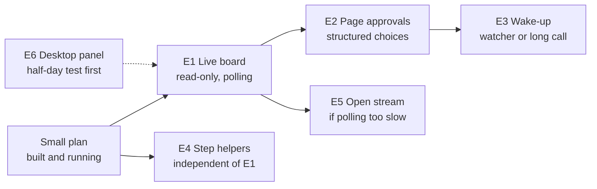

# Job fan-out — later extensions plan

2026-10-22 · Brahm Dorst · living copy: https://claude.ai/artifact/AMLwH5M4oCfsCNMAtcAgYc

## Starting point and when to extend

This plan picks up after the small plan is built and running: [Job fan-out with chat approvals](https://claude.ai/artifact/JfTJ43GnznxWkHZksCvcUP). Nothing here is needed for that plan to work.

**What the small plan already gives you**

- A foreman `/draft` session that starts up to three job helpers, each on a job touching different material.
- Helpers that park a job with its question (`awaiting` step) and release it to Ready, instead of asking.
- Questions answered in chat, recorded by `answer_step`, and a fresh helper started on the job.
- A Needs you lane on the Job Board, refreshed whenever the board is re-rendered.
- A longer write-lock wait, and a `westlaw_slot` so only one helper uses Westlaw at a time.

**Signs it is time to extend**

- You keep asking the foreman for a re-render just to see where things are. That points to the live page (E1).
- You want to answer helpers' questions while away from the chat, or in a batch at the end of the day. That points to page approvals (E2) and a wake-up (E3).
- Jobs with many independent steps, such as noting up a dozen authorities, run noticeably slowly. That points to step helpers (E4).
- None of these? Do not extend. The small plan is the whole product until one of them shows up.

## Extensions at a glance

The live board comes first; step helpers stand apart. Arrow: needs first. Dotted: may inform.

Page approvals and the wake-up only make sense once the board is live, so E1 always comes first on that path. Step helpers can be added straight onto the small plan at any time.

## The extensions compared

E1 is the foundation for E2 and E3; E4 stands alone and can come at any time.

| Extension | What it adds | Needs first | Build it when | Main risk |
| --- | --- | --- | --- | --- |
| E1 Live Job Board (read-only) | The page updates every few seconds while helpers work, with a Live or Snapshot badge | Small plan; ideally temp-and-rename writes | You re-render just to check progress | Privileged board state readable by anything on the PC holding the page token |
| E2 Page approvals | Approve, reject or pick an option on the page, without the chat | E1 | You want to answer away from the chat | A click is weaker proof than your words in chat |
| E3 Waking the foreman | The foreman notices an answer given on the page and restarts that job | E2 | Answers can arrive outside the chat | Long calls over the bridge to your PC may be cut off |
| E4 Step helpers | Independent steps of one job run side by side | Small plan | Jobs with many independent steps are slow | More agents, more tokens, a second place for state to go wrong |
| E5 Open stream for page updates | Pushed updates instead of polling | E1 | Polling proves too slow | The token cannot go in a header; listener pauses on writes anyway |
| E6 Desktop app panel | Progress shown beside the chat in the Claude app | A half-day test | The page proves awkward to keep open | Unknown whether a panel can reach the data server |

## Build notes

Each extension adds new columns, keys, tools or routes only; nothing the small plan built changes shape.

### E1 Live Job Board (read-only)

- **Change counter.** A `db_meta` key `board_seq:<proceeding>`, moved by a database trigger on the job tables. A trigger catches writes from tools, from free `drafting_data__execute` scripts and from the listener alike. The revision cannot serve: it deliberately does not move on job-table writes.
- **State route.** `POST /boards/:id/state` on the existing listener, with the page token and `since` in the body, the same shape as the Defer route. Returns fresh board JSON when `board_seq` has moved, otherwise "no change".
- **Page.** On load it calls `/health`, as Loose Threads already does. If the listener answers, it polls every 3 to 5 s and redraws from the fresh JSON. It shows "Live" or "Snapshot as of 11:36". The static file stays the snapshot for other devices and for when no session runs.
- **Safe reads.** The state read retries on a malformed or busy file. Switch the write copy-back to temp-and-rename first if the small plan has not already, after checking SQLite's Windows file-sharing flags allow it.
- *Gate:* a write from a second session shows on the page within a few seconds; a request with `Origin: null` and no token gets 403; the page survives a read during a write.

### E2 Page approvals

- **Route.** `POST /steps/:ticket/:ordinal/answer` with the page token, the answer and the question's `asked_at`. A stale page answering a re-asked question is refused.
- **Scope.** Structured choices only: approve, reject, pick an option. Worded answers, Goal statements and paragraph rewordings stay in chat, where the practitioner-words gate can see them.
- **Record.** Reuses the small plan's `answer_step` write, with `answered_via: page` and `answered_by: page`. First answer wins, chat or page.
- *Gate:* Brahm's decision on page-approval trust (below), and a test that a page answer and a chat answer racing each other leave exactly one answer.

### E3 Waking the foreman

- **Tool.** `board__wait(db_path, since_seq, timeout_s)` on the data server returns when `board_seq` moves or the timeout passes. It must wait on a timer and never block the process, because every other call and the listener share its one thread.
- **Watcher.** One background helper loops on `board__wait` with timeouts of 60 s or less, since the bridge's per-call ceiling is unknown (`device_bash` caps at 180 s). Its return wakes the foreman, which reads the Needs you lane and starts a fresh helper for any answered job.
- **Possible shortcut.** If the bridge allows long calls and forwards progress messages, the foreman can call `board__wait` itself with a long timeout. Claude Code moves an MCP call past 2 minutes to the background and reports when it settles. Measure first.
- *Gate:* an answer given on the page restarts its job within a minute, with no chat message.

### E4 Step helpers

- **Flag.** `ticket_steps.parallel_safe` (0/1), set when the plan is written, read by the job helper.
- **Rule.** A step helper does one step and returns its result. Only the job helper stamps steps. Serial steps, such as a research chain, stay with the job helper so one finding can shape the next.
- **Good candidates.** Noting up each authority; fetching each decision on a job's "sources to get" list; filling independent fields of a form.
- *Gate:* one writer per job holds under load, and no write fails on the lock across a full board run.

### E5 Open stream

Replace polling with server-sent events only if polling proves too slow. The token would have to travel in the URL, which ends up in logs, and the listener still pauses during every write.

### E6 Desktop app panel

A half-day test first: can a Claude app panel reach the data server and redraw the board? If yes, it may be a better home than the page for progress. If no, drop it.

## Risks that arrive with the extensions

Read security is the one risk that must not be got wrong; the rest are about speed and reliability.

| Risk | Arrives with | Why it matters | What we do about it |
| --- | --- | --- | --- |
| Read security | E1 | The listener answers pages with `Origin: null`, which also covers a sandboxed iframe on any website, so the token is the only guard. The token is embedded in the page HTML, which OneDrive copies to every synced device. Board state is privileged work product | Every new read route checks the per-proceeding token, exactly as Defer does. No unauthenticated board read, ever. The token is useless off this PC because the listener binds `127.0.0.1` only. Say plainly in the security note that anything on this PC that can read the HTML can read the board. Trim `/health`, which today reveals the process id and plugin version |
| Data server pauses on every call | E1, E3 | Every database call runs synchronously on the data server's one thread, so the listener and all other tools wait while one runs | Poll every 3 to 5 s, not faster; `board__wait` waits on a timer; measure the stutter in E1 |
| Torn reads | E1 | Writes copy the whole file back in place, so a reader can catch a half-written file | Retry the read; move to temp-and-rename writes |
| Page approval trust | E2 | A click proves only that a page rendered on this machine; the practitioner-words gate reads chat turns and cannot see it | Structured choices only; record `answered_via: page` and `asked_at` |
| Long calls cut off | E3 | The bridge's per-call ceiling is unknown | Watcher with 60 s waits; measure before trying the shortcut |
| Is the listener up | E1, E2 | It exists only while a data server runs; a takeover gap can last 15 s | Page reconnects quietly and shows "Snapshot as of" meanwhile |
| Token cost | E4 | Step helpers multiply agents | Step helpers only for steps flagged parallel-safe; keep the cap on job helpers |

## Alternatives already rejected

Extending the existing listener beat each of these because it already runs, already guards writes with a token, and already sits beside the database.

| Alternative | Why not |
| --- | --- |
| A new standalone web server | Duplicates the listener, adds a process to install and keep alive, and needs a second trust story |
| A status file the page reloads (the `workboard-status.js` way) | Read-only, and frequent writes from many helpers into a synced folder invite sync churn and conflict copies. Still fine for the render job's coarse status |
| Serving the page only from `http://127.0.0.1` | The page would die with no session open and could not be read on another device. Acceptable only behind the static snapshot |
| A hosted artifact | The retired hosted Work Board went this way; privileged board state should not leave the PC |

## Review findings that bear on the extensions

These come from the Fable review of 2026-10-22, checked against the lawyer plugin bundle v0.8.1 and Claude Code's documentation.

1. **Torn reads.** The live database file is replaced in place by `shutil.copy2`, not temp-and-rename, so a read-only reader can see a half-written file (`litigation-mcp.js` ~83095-83200).
2. **One thread.** Every database call blocks the data server's Node thread, so the listener stalls during each call.
3. **Token on every device.** The page token is embedded in the page HTML, so it travels with OneDrive. `/health` is unauthenticated and reveals the process id and plugin version.
4. **Change counter.** Bumping `board_seq` from each tool would miss free `drafting_data__execute` scripts, which still stamp steps. Hence a trigger.
5. **Page to listener.** POST from a `file://` page is proven by the Defer button. An open stream is unproven and would need the token in the URL.
6. **Long calls over the bridge.** Claude Code moves MCP calls past 2 minutes to the background, with a 5-minute idle cut-off for connector-type servers. The remote-devices bridge's own ceiling is undocumented.
7. **One data server or many.** Whether the desktop app keeps one data server for all remote sessions or one per session is undocumented, so which process holds the listener is unverified.

Sources: [Claude Code sub-agents](https://code.claude.com/docs/en/sub-agents) · [hooks](https://code.claude.com/docs/en/hooks) · [MCP](https://code.claude.com/docs/en/mcp).

## Decisions to make before extending

- [ ] Which sign above has actually shown up, and so which extension to build first
- [ ] Whether the page may take approvals at all (E2), and which kinds beyond approve, reject and pick an option
- [ ] Watcher helper or direct long call for waking the foreman (E3), once the bridge's ceiling is measured
- [ ] Polling interval for the live page (proposal: 3 to 5 s)
- [ ] Whether to run the desktop panel test (E6) before building E1
- [ ] How a scheduled, unattended run treats an awaiting step once page approvals exist: park it, or skip the job
