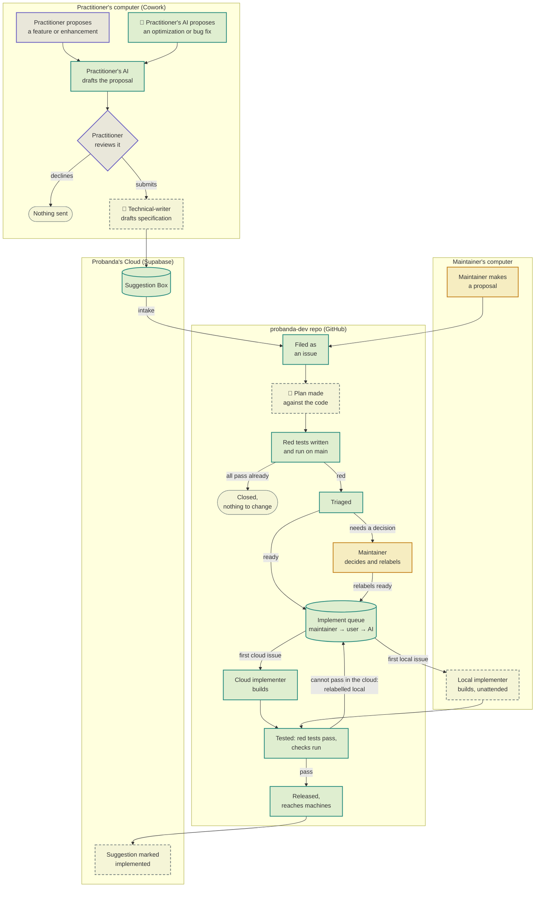

# Plan: Suggestion Implementation Lifecycle

**Status (2026-10-25).** Draft for Brahm's approval. Decisions 1 to 22 below were settled in the suggestion design discussion of 2026-10-25, and reviewed twice. Design questions Q3 to Q6 are still open, and each phase says which of them it waits for. The parts marked **Built** run today. Nothing else in this plan is built.

## The lifecycle

The dashed boxes are still to build. Teal runs automatically, violet is the practitioner, amber is the maintainer, and 🤖 marks a step that uses a custom agent rather than only a skill. The live page, with a table of what runs at each step, is https://claude.ai/artifact/5paaXhEcnD4Mn2cuqCzeZg.

The decisions refine the diagram in five places:

- "Practitioner reviews it" is the suggestion card (decisions 5 to 11). Its buttons are **Submit Suggestion** and **Dismiss**.
- "Technical-writer drafts specification" includes a second agent that checks the specification as a backstop (decision 18).
- "Plan made against the code" is the `fix-planner` agent, and both implementer boxes run the `fix-maker` agent (decisions 20 and 21).
- Every item of a suggestion reaches "Maintainer decides and relabels", because only a person approves or declines (decisions 17 and 20).
- The diagram leaves out the status badges, the Past suggestions page and withdrawal (decisions 13 to 17).

## Goal

A suggestion exists so that a pain point, stated or not and felt or not, reaches the people who change Probanda with enough detail that they can fix it, or decide not to, without going back to the practitioner. It passes when:

- **(a)** a maintainer can accept or decline each item without asking the practitioner anything, measured as the share of items declined for lack of detail; and
- **(b)** someone who knows the firm's clients can't tell which client, matter, person, document or file it came from. The scrub works to this standard. Its automatic check is a cross-check that the payload holds no token found in the local client, matter, contact or folder-name records.

The practitioner can later see exactly what was sent, withdraw it, and see what happened to it.

## Decisions

### Audiences and scope

1. The audiences are the practitioner, the maintainer (whoever changes Probanda's source), and whoever triages many suggestions together.
2. Every suggestion has a pain point. When the practitioner leaves it unstated, the card shows a best guess labelled "our guess, edit if wrong", first on the card. Nothing is asked in chat.
3. Pain the practitioner never felt counts: cost, reliability, accuracy, confidentiality near-misses.
   - **When it appears:** an AI-noticed card appears when the session next pauses for the practitioner after the observation. At most one appears per day, across sessions. None appears for a fingerprint the practitioner dismissed or sent within 30 days, or for the same plugin version.
   - **What it carries:** the raw observation, taken only from Probanda's own output (token counts, tool errors, plugin text), never from client documents or the practitioner's words. It also carries a fingerprint: plugin, version, skill and kind.
   - **Merging:** merging by fingerprint is a triage view over separate records, never one merged record.

### Terms

4. Practitioners see one term, **Suggestion**, whoever started it. The card opens with "Probanda noticed:" or "You suggested:". The origin is also a field for triage.

### The card

The card is `Suggestion-<id>.html`, shown as a file card and served by Probanda's local server.

5. The chat shows no suggestion talk at all. The file card is its only sign.
6. The card shows, in this order:
   1. the origin cue;
   2. the pain point, described by how it affected the practitioner;
   3. the suggestion;
   4. an optional comment box with the grey placeholder "Please don't name clients, matters or people.";
   5. the line "Probanda receives only what you see here, plus technical details about the Probanda software on this computer.", with a "Show technical details" link to the environment facts;
   6. the line "You can see this later, with its status, under Past suggestions.";
   7. **Submit Suggestion** and **Dismiss**.
7. The pain point and the suggestion text can be edited in place before sending.
8. On the click, the edited and typed text runs through the local cross-check and through patterns for paths, emails, dates and amounts. On a match, a one-line prompt offers Remove and Send anyway.
9. Dismiss sends nothing, is recorded locally for the suppression in decision 3, and closes the card. If the card can't be closed, Dismiss greys it out and replaces it with one button, "Restore Suggestion". Every button gives visible feedback.
10. The click is the practitioner's approval of the product idea, the content and the confidentiality alike. Nobody tells them they are reviewing, and they are never asked to review technical detail.
11. Card order, labels and fixed strings are built into the page, not left to agent instructions.

### Confidentiality

12. Three layers protect client information:
    1. Before the card is shown, the scrub removes names and indirect identifiers (unique facts, exact dates, amounts, folder names) to the standard of goal test (b), and the local cross-check runs.
    2. The click is the final human gate.
    3. The cloud side treats any identifying content found at triage as a leak to purge.

    The practitioner's withdrawal is a fourth. Nothing is sent that contains a client fact the practitioner didn't see on the card.

### Sending and status

13. Status feedback appears on the card only: "Sending...", then "Delivered ✓" or "Not sent, will retry". Errors are in plain language and never offer technical details. The raw cause is kept in the local record.
14. At the click, the local server saves the exact payload locally first, then sends it. A failed send shows "Not sent" and retries at the next session.
15. Probanda's Cloud knows which Lawyer account sent each suggestion. This is Account Information.
16. The Past suggestions page shows the local copy word for word, mainly so the practitioner can check that nothing confidential was sent. The technical-writer's specification can be viewed there on request.
    - **Withdrawal:** withdrawing deletes the cloud record. If triage has begun, it also notifies the maintainer to purge derived records.
    - **Badge:** "Withdrawn before review" or "Withdrawn; copies being removed".
17. The status badges are Submitted, Under Review, Approved or Declined, and Implemented in `<plugin> <version>`.
    - **Reasons:** Approved, Declined and Implemented show a reason as visible text, extremely short and readable by a non-technical person. Submitted needs none. A reason is written for every sender of a merged problem and never quotes submitted text.
    - **When each is set:** Submitted on write. Under Review when triage opens the record. Implemented when the release that includes a fix commit naming the suggestion id is published.
    - **Set by a person:** only Approved and Declined, each with its reason.

### Agents

18. **`technical-writer`** runs on Opus 5.5, on the practitioner's machine and their Claude plan. It starts after the click and writes a specification.
    - **Who pays:** practitioners pay for planning from day 1, because changing that later would cost trust. They are told once, at setup or in the terms, that sending a suggestion uses their Claude plan.
    - **What it reads:** only the card, the environment facts and Probanda's own installed material. Never the conversation, documents or tool arguments.
    - **Backstop:** a second agent checks the specification. The specification and the suggestion both go to the Suggestion Box.
19. **Environment facts** are:
    - Probanda's own tools, both the visible ones and the expected ones that are missing;
    - other tools, as a count only;
    - plugin names and versions;
    - the host (Cowork or Code) and the OS.

    Code, not instructions, excludes usernames, hostnames and paths. The plan is carried out in Claude Code, which must not assume Cowork's tools.
20. **`fix-planner`** runs on Opus 5.5 at high effort and high freedom, and is read-only on probanda-dev. It replaces `/specification-planning`. It runs first and returns, for each item, a recommendation with a check that would fail if the pain remained, plus the plan for the items it recommends. The maintainer approves or declines each item.
21. **`fix-maker`** runs on Opus 5.5 at medium effort and low freedom. It carries out only approved items.
22. Briefs are goal-style, with a done-when for each agent:
    - card building and scrubbing: done when the local cross-check passes and the card is shown;
    - `technical-writer`: done when every fact in the specification traces to the card or to Probanda's own material, and the backstop passes;
    - `fix-planner`: done when each item has a runnable check;
    - `fix-maker`: done when those checks and the plugin's own checks pass.

    The list "where / the pain / what happened / the changes / what counts as wrong / done when" is a reminder line, not a form.

## Already built

| Step | Where |
|---|---|
| Suggestion drafting and the Yes / No / Modify review | `.claude/skills/suggestion/SKILL.md` sections 1 and 6, and `.claude/skills/work/references/suggestion-box.md` step 6 |
| Loose-thread suggestions from `/draft` and `/work` | `litigator:suggestion-evaluator`, through `suggestion-box.md` |
| Submit tool | `suggestion_box__submit` in `source/researcher/commons-mcp/src/suggestion-box/tools.ts` |
| Suggestion Box: save, then start intake | `cloud/legal-commons/supabase/functions/suggestion-submit/`. Table: `cloud/suggestions/suggestions.sql` |
| Status read and the outcome check at session start | `suggestion-status` function, and the outcome check in `/suggestion` |
| Intake: file each suggestion as an issue with its lane label | `.claude/commands/intake-suggestions.md` |
| Triage: repeat check, plan, red tests, decide, write | `.claude/commands/triage-issue.md` steps 2 to 6. The planner is `source/developer/agents/suggestion-planner.md` |
| One implement queue, claims, implementer lock, label trigger | `.claude/commands/implement-suggestions.md` and `docs/agents/issue-tracker.md` |
| Status writes | `suggestion-set-status`, which accepts only `approved`, `approved in part` and `rejected`, and only from `new` |

## Constraints

- **Commandment 3:** client information stays on the practitioner's machine. The card, the scrub, the cross-check, the local record and the `technical-writer` all run there. What leaves is only what the card shows, plus the environment facts and the specification.
- **Commandment 2:** decision 15 adds Account Information to the cloud. The table comment "nothing here names who sent it" in `suggestions.sql` changes with it.
- **Commandment 4:** `technical-writer` and its backstop read only Probanda's installed material, never probanda-dev. `fix-planner` and `fix-maker` run in Probanda's Cloud or on the maintainer's machine.
- **Commandment 7:** the card, the local record and the Past suggestions page are files Probanda creates.
- **Layering:** `lawyer` names nothing in another plugin. The submit tool ships in `researcher`, so `lawyer` keeps posting only when `researcher` is installed.
- **Old copies:** a copy of the plugin that sends none of the new fields keeps working. Each cloud change is additive.
- **Version:** decide each release by the version rule in `CLAUDE.md`.

## Phases

Each phase ends with a commit to `main` and a release where a plugin changes. Phases 1 and 2 come first because every later phase writes to them.

### Phase 1. Cloud records

- Replace the status set with `submitted`, `under review`, `approved`, `declined`, `implemented` and `withdrawn`. Existing rows map `new` to `submitted`, `approved` to `approved` and `rejected` to `declined`. `approved in part` stays until Q3 is answered.
- Add columns: `reason`, `implemented_in` (for example `lawyer 0.10.2`), `specification`, `comments`, and the sending install key (decision 15).
- `suggestion-set-status` accepts the new transitions. It requires a reason for `approved`, `declined` and `implemented`. Only `under review` may be set without a person.
- `suggestion-status` returns the badge, the reason and `implemented_in` to the key that sent the suggestion.
- Add a `suggestion-withdraw` function for the sending key. Before triage, it deletes the row. After triage, it deletes the content and keeps a tombstone holding only the id and the issue number.
- **Done when:** each function's tests cover every transition, including a refused one. A submit with none of the new fields still saves.

### Phase 2. Local record, sending and Past suggestions

- At the click, the `lawyer` local server saves the exact payload, then sends it. A failed send retries at the next session (decisions 13 and 14).
- The Past suggestions page shows each local copy word for word, with its badge and reason, the specification on request, and a Withdraw button (decision 16).
- The session-start outcome check reads the new badges.
- **Done when:** a test sends with the network down, then retries and delivers. The page shows a sent payload byte for byte.

### Phase 3. The card

- Build `Suggestion-<id>.html` on the local server (`source/lawyer/mcp/src/page-api/`), with the order and fixed strings of decisions 6 and 11 built into the page.
- The click-time check is decision 8, and Dismiss and Restore Suggestion are decision 9.
- Replace Yes / No / Modify in `/suggestion` sections 1 and 6 and in `suggestion-box.md` step 6. The chat shows only the file card (decision 5).
- **Waits for:** Q3 (one card with items, or one card per item) and Q5 (how far the practitioner's words are restructured).
- **Done when:** a page test finds every fixed string in order. A planted email, path, date or amount triggers Remove / Send anyway.

### Phase 4. Scrub and cross-check

- Before the card is shown, scrub to goal test (b), then cross-check against the local client, matter, contact and folder-name records (decision 12, layer 1).
- **Done when:** a test with invented records finds a planted client token in each card field and blocks the card.

### Phase 5. AI-noticed suggestions

- Raise a card from Probanda's own output only, with a fingerprint, at most one per day, and the 30-day and same-version suppression (decision 3).
- **Waits for:** Q6, and the evaluator decision below.
- **Done when:** a test raises one card, suppresses a second on the same day, and suppresses a dismissed fingerprint for 30 days.

### Phase 6. `technical-writer` and its backstop

- Ship both agents with Opus 5.5.
  - **Writer's tools:** a read of Probanda's installed material (`skill_source__read`) and nothing that reaches files, mail or matter data.
  - **Writer's goal:** forbids reading identifying client or matter data. The goal removes the inclination, and the tool list removes the ability.
- Add an environment-facts tool that returns only the facts in decision 19. Code drops usernames, hostnames and paths.
- `suggestion_box__submit` and `suggestion-submit` carry `specification` and `comments`, under the same redaction check as the body.
- When a practitioner asks, show the specification in full and explain both safeguards in the present tense.
- Tell the practitioner once, at setup or in the terms, that sending uses their Claude plan.
- **Done when:**
  - a check fails if either agent's `tools` gains a file, shell, web or client-data tool;
  - the environment-facts test finds no username, hostname or path;
  - the backstop rejects a specification holding a fact that isn't on the card or in Probanda's material.

### Phase 7. Triage with `fix-planner`

- Triage step 1 sets `under review`.
- `fix-planner` replaces `developer:suggestion-planner` in triage step 3. For each item it returns a recommendation, a check that would fail if the pain remained, and the plan for what it recommends. When the suggestion carries a specification, it checks it against the code instead of writing one.
- The built red tests (triage step 4) run `fix-planner`'s checks.
- A suggestion issue always ends `ready-for-human`, with one open decision per item.
- The maintainer approves or declines each item with its short reason, through the developer plugin's triage skill, which calls `suggestion-set-status`. The maintainer then relabels the issue `ready-for-agent`, and the label trigger starts the build.
- **Done when:** a dry run on a past suggestion issue gives every item a runnable check and ends `ready-for-human`. A status write without a reason is refused.

### Phase 8. Building with `fix-maker`

- Both implementers dispatch `fix-maker` for approved items only.
- Each fix commit names the suggestion id as `Suggestion <id>`.
- **Done when:** a run on a test issue with one approved and one declined item builds only the approved one, and its commit names the id.

### Phase 9. Implemented status

- When a release that includes a fix commit naming a suggestion id is published, set `implemented` with `implemented_in` and a reason. See open decision 7 for which release counts.
- **Done when:** a test release with one such commit sets that suggestion's status, and the session-start check reports it.

### Phase 10. Local implementer, unattended

- Works the same queue as the cloud implementer. It takes the first `ready-for-agent` + `local` issue and uses the same claim comments, under its own lock so it never blocks cloud runs. See open decision 8 for how it starts.
- **Done when:** with one cloud and one local issue queued, each implementer takes only its own.

### Phase 11. Withdrawal and purge

- A tombstone left by `suggestion-withdraw` is picked up by the next intake run, which labels the issue `withdrawn`, removes the suggestion text from the issue body, closes it, and drops it from the queue. The maintainer purges any other copy.
- **Done when:** a test tombstone closes its issue, and no submitted text remains in the issue body.

### Phase 12. Words and docs

- Update `GLOSSARY.md` (Suggestion, Pain point, Done-test, Preview) and add the badges.
- Update `docs/agents/issue-tracker.md` for per-item approval, the `withdrawn` label and the local implementer.
- Update #193 to point here: this plan supersedes its Agent Brief where they differ.

## Open decisions

1. **Q3. One card with items, or separate suggestions?** Do pain points, changes, constraints and rejected alternatives, and evidence go on one card with atomic items, or as separate suggestions? One badge can't show mixed statuses across items that are approved one by one. This blocks Phases 1 (the fate of `approved in part`), 3 and 7.
2. **Q4. Mockups.** When does Probanda volunteer a mockup, how is it kept free of client data, and how does it travel? This blocks part of Phase 3.
3. **Q5. Restructuring.** How much may the practitioner's words be restructured, and what approval protects their meaning? This blocks Phase 3.
4. **Q6. Who starts a suggestion.** How do suggestions started by the practitioner and by the AI differ? Decisions 2 to 4, 10 and 18 largely settle this. It blocks Phase 5.
5. **The evaluator route.** `litigator:suggestion-evaluator` builds loose threads from the session, which decision 3 excludes. Options:
   - **(a)** limit its input to Probanda's own output (recommended, because it keeps the `/draft` and `/work` route);
   - **(b)** retire it in favour of Phase 5;
   - **(c)** do nothing.
6. **Which plugin ships `technical-writer`.** Options:
   - **(a)** `researcher`, next to the submit tool (recommended, because only `researcher` can send);
   - **(b)** `lawyer`.
7. **Which release counts as "Implemented".** Options:
   - **(a)** the public publication through `publish-public` (recommended, because that is when practitioners receive the fix);
   - **(b)** the push to probanda-dev's `main`, which reaches only the maintainer's machines.
8. **How the local implementer starts.** Options:
   - **(a)** a daily scheduled task on the maintainer's computer (recommended, because it needs no pasted command);
   - **(b)** a `/loop` session left running;
   - **(c)** do nothing, and the maintainer keeps running `/implement`.

## Risks

- **Linux shims:** a red test run in the cloud sandbox on Linux can fail because of a shim rather than the code. The implementer re-runs each red test on the base before building, which narrows this but doesn't remove it.
- **Per-item approval changes intake:** triage now always needs the maintainer for a suggestion issue, so the time from suggestion to build depends on the maintainer's response time. Today, triage queues an approved plan without the maintainer.
- **Cloud schema:** `suggestions.sql` is applied by hand to the Supabase project, which needs credentials the cloud sandbox lacks. Phase 1 is a local issue.
