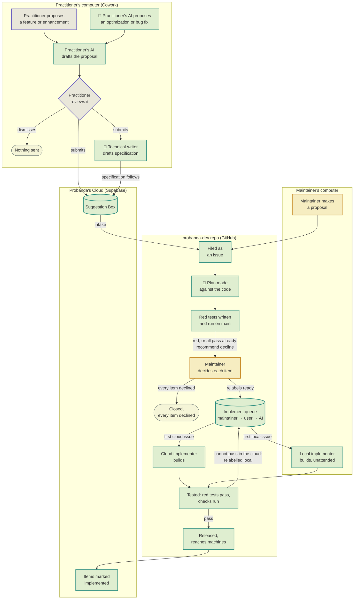

# Plan: Suggestion Implementation Lifecycle

**Status (2026-10-26).** Built. Approved by Brahm for execution. The design is settled in `docs/Plans/2026-10-25_suggestion-design.md`, decisions 1 to 28, which is the source of truth: this plan cites decisions by number and does not restate them. Open decisions 1 to 5 below were settled by Brahm on 2026-10-26. Phases 1 to 12 are built and on `main`. **Already built** lists where each part lives and the steps Brahm did by hand on 2026-10-26: the repository secret `SUPABASE_SUGGESTIONS_SECRET_KEY` (Phase 9), the local implementer's scheduled task, which runs overnight outside Claude's peak hours (Phase 10), and the comment on #193 (Phase 12). The cloud deploy of Phases 1 and 7 is done.

## The lifecycle

Every box is built. Teal runs automatically, violet is the practitioner, amber is the maintainer, and 🤖 marks a step that uses a custom agent rather than only a skill. The live page, with a table of what runs at each step, is https://claude.ai/artifact/5paaXhEcnD4Mn2cuqCzeZg.

The design refines the diagram in five places:

- "Practitioner reviews it" is the suggestion card (decisions 5 to 11 and 23 to 28). Its buttons are **Submit Suggestion** and **Dismiss**.
- The suggestion is sent at the click. "Technical-writer drafts specification" runs after it, with a backstop agent, and its specification follows (decision 18).
- "Plan made against the code" is the `fix-planner` agent, and both implementer boxes run the `fix-maker` agent (decisions 20 and 21).
- Every item of a suggestion reaches "Maintainer decides each item", because only a person approves or declines (decisions 17 and 20). A suggestion that already works, or repeats an earlier one, also goes there, with a recommended decline.
- The diagram leaves out the status badges, the Past suggestions page and withdrawal (decisions 13 to 17).

## Already built

Phases 1 to 12 are built. The last column is what Brahm did by hand.

| Step | Where | By hand |
|---|---|---|
| Suggestion Box: per-item records, the badge, the sending key, withdrawal and specifications (Phase 1) | `cloud/suggestions/suggestions.sql`, and the functions `suggestion-submit`, `suggestion-status`, `suggestion-set-status`, `suggestion-list`, `suggestion-attach-specification` and `suggestion-withdraw` under `cloud/legal-commons/supabase/functions/`. Applied and deployed by `cloud/suggestions/tools/deploy-suggestions.ps1`; the maintainer's tool is `cloud/suggestions/tools/triage.mjs` | Nothing: deployed |
| Local record, sending and Past suggestions (Phase 2) | `source/lawyer/mcp/src/suggestions/store.ts`, `send.ts` and `page.ts`. `lawyer`'s server posts to `suggestion-submit` itself, and `suggestion_box__submit` has left `researcher` (open decision 5) | |
| Cross-check and environment facts (Phase 3) | `source/lawyer/mcp/src/suggestions/crosscheck.ts`, `records.ts` and `environment.ts`; the stop lists under `.claude/skills/suggestion/references/stop-words/` | |
| The card, its scrub and its mockup, in place of Yes / No / Modify (Phase 4) | `.claude/skills/suggestion/SKILL.md` sections 5 to 7; `source/lawyer/mcp/src/suggestions/card.ts`, `card-page.ts` and `mockup.ts`, served through `source/lawyer/mcp/src/page-api/server.ts`; the placeholders under `.claude/skills/suggestion/references/mockup/` | |
| AI-noticed suggestions; the evaluator retired (Phase 5) | `source/lawyer/mcp/src/suggestions/observation.ts`, the Stop hook `source/lawyer/hooks/ai-noticed-card.py` and `/suggestion` section 9. `/draft` and `/work` report through `suggestion_observation__record` (`.claude/skills/work/references/suggestion-box.md`), and `litigator:suggestion-evaluator` is gone (open decision 1) | |
| `technical-writer` and its backstop (Phase 6) | `source/lawyer/agents/technical-writer.md` and `spec-backstop.md`, `source/lawyer/mcp/src/suggestions/specification.ts` and `/suggestion` section 10. The tool check is `scripts/check_plugin_agents.py` | |
| Status read and the outcome check at session start | `suggestion_box__status` in `lawyer`'s data server, and the outcome check in `/suggestion` section 1 | |
| Intake: file each suggestion as an issue with its lane label | `.claude/commands/intake-suggestions.md` | |
| Triage with `fix-planner`, per-item decisions (Phase 7) | `.claude/commands/triage-issue.md` steps 1 to 6, with `source/developer/agents/fix-planner.md` (its dry run is `docs/Plans/2026-10-26_fix-planner-dry-run.md`). Each item is decided through `.claude/skills/hitl-triage/references/suggestion-route.md`, by `triage.mjs set-item`. The verbatim guard is `scripts/check_verbatim.py` | Nothing: deployed |
| One implement queue, claims, implementer lock, label trigger | `.claude/commands/implement-suggestions.md` and `docs/agents/issue-tracker.md` | |
| Building approved items with `fix-maker`, one commit per item named `Suggestion <id> item <n>` (Phase 8) | `source/developer/agents/fix-maker.md`, dispatched by `.claude/commands/implement-suggestions.md` step 5 and `.claude/skills/hitl-triage/references/suggestion-route.md` step 6. The approved set is `scripts/select_approved_items.py`; the commit check is `scripts/check_fix_commit.py` | |
| Items marked implemented when their fix is published (Phase 9) | The scan step of `.github/workflows/publish-public.yml`, which runs `scripts/implemented_scan.py` | Done 2026-10-26: the repository secret `SUPABASE_SUGGESTIONS_SECRET_KEY` |
| Local implementer: the `local` lane of the queue, under its own lock, in its own clone, started by a daily scheduled task (Phase 10) | `.claude/commands/implement-suggestions.md` **Local lane**. The lane chooser and both locks are `scripts/choose_issue.py`; the clone guard is `scripts/local_implementer_guard.py`; the task is `scripts/local-implementer/` | Done 2026-10-26: the task is registered with `scripts/local-implementer/register-local-implementer.ps1` |
| Withdrawal: the issue labelled `withdrawn`, closed and dropped from every queue (Phase 11) | `suggestion-withdraw` and the Withdraw button on Past suggestions; `.claude/commands/intake-suggestions.md` step 3 with `scripts/withdrawals.py`; `scripts/choose_issue.py` | |
| Words and docs (Phase 12) | `GLOSSARY.md` and `docs/agents/issue-tracker.md` | Done 2026-10-26: #193 points here |

## Constraints

- **Commandment 3:** client information stays on the practitioner's machine. The card, the scrub, the cross-check, the local record and `technical-writer` all run there. What leaves is only what the card shows, plus the environment facts, the specification and the backstop result.
- **Commandment 2:** decision 15 adds Account Information to the cloud. The table comment "nothing here names who sent it" in `suggestions.sql` changes with it.
- **Commandment 4:** `technical-writer` and its backstop read only the plugins' shipped files, never probanda-dev. `fix-planner` and `fix-maker` run in Probanda's Cloud or on the maintainer's machine.
- **Commandment 5:** the local store has no table or column per kind (decision 14), and it is not one of the legacy stores.
- **Commandment 7:** the card, the mockup, the local record and the Past suggestions page are files Probanda creates.
- **Layering:** `lawyer` names nothing in another plugin. Open decision 5 settles which plugin sends.
- **Withdrawal and git history:** pushed history is never rewritten, so derived records never quote submitted text (decision 16).
- **Version:** decide each release by the version rule in `CLAUDE.md`. Phase 1 renames the statuses that an old copy's session-start check reads, so the releases that ship Phases 1 and 2 are minor bumps.

## Phases

Each phase ends with a commit to `main` and a release where a plugin changes. Phases 1 and 2 come first because every later phase writes to them.

### Phase 1. Cloud records

- Add the whole additive schema at once, because each later column would cost another manual step (see Risks):
  - per suggestion: `origin`, `fingerprint`, `raw_observation`, `environment_facts`, `comment`, the sending install key (decision 15), `issue_number` (written by intake), `specification`, `backstop_result`;
  - per item, in order: text, status, reason, decline category, `implemented_in`, plus the suggestion's one optional mockup HTML.
- Statuses: the suggestion holds `submitted`, `under review` and `withdrawn`. Each item holds `undecided`, `approved`, `declined` and `implemented`. The badge is computed from them by decision 17's rule.
- `approved in part` is dropped. Each existing row gets one item holding its body. `new` maps to `submitted`, `approved` and `approved in part` map to that item approved, and `rejected` maps to declined, each with the reason "Decided before reasons were recorded".
- Who writes what: `under review` and `implemented` are written by Probanda's automation keys, `approved` and `declined` by the maintainer with a reason (and a category for `declined`), and `withdrawn` by the sending install key.
- `suggestion-set-status` gains a per-item form, `(id, item, status, reason, category)`. Until Phase 7 changes the triage skill, the old whole-suggestion write is still accepted and applied to every item.
- `suggestion-status` returns the badge, the per-item statuses, reasons and releases to the key that sent the suggestion.
- Add `suggestion-attach-specification`, keyed to the sending install key, so the specification and backstop result follow the suggestion (decision 18).
- Add `suggestion-withdraw` for the sending key. Before triage, it deletes the row. After triage, it deletes the content and keeps a tombstone holding only the id and the issue number.
- **Done when:** each function's tests cover every transition, including a refused one. A submit with none of the new fields still saves, and a legacy row reads back as one item.

### Phase 2. Local record, sending and Past suggestions

- The local store is one store under `${CLAUDE_PLUGIN_DATA}` (decision 14). Each suggestion keeps the exact bytes sent, with the mockup embedded as sent.
- At the click, the local server saves the exact payload, then sends it, and the card shows decision 13's statuses. A failed send retries when the server next starts, and stops after seven failed sessions (decision 14). Which plugin's server sends is open decision 5.
- The Past suggestions page shows, for each sent suggestion: the pain point; each item with its status, reason and release; the brackets as shown on the card; the comment; the raw observation; the environment facts; and the mockup, inside a sandboxed iframe (no permissions, `srcdoc` from the stored bytes). The specification and backstop result show on request. Each entry has a Withdraw button (decision 16). Dismissed cards do not appear (decision 9).
- A withdrawal is stored locally with its badge, and the page never asks the cloud about a withdrawn suggestion.
- The session-start outcome check reads the new badges. When one changed, it shows the Past suggestions page as a file card, with no chat talk (decision 5).
- **Done when:** a test sends with the network down, then retries and delivers. The page shows a sent payload and its mockup byte for byte against the stored record.

### Phase 3. Cross-check and environment facts

- The cross-check tool, with decision 8's token rule, reads the client, contact, matter, folder-name, document-title and file-name records through `lawyer`'s data server. The stop lists ship with the plugin.
- The environment-facts tool returns only decision 19's facts. Code drops usernames, hostnames and paths.
- **Done when:**
  - a test with invented records finds a planted client token in each field;
  - a card holding only Probanda's template words and common English passes;
  - the environment-facts test finds no username, hostname or path, and runs with Cowork's tools absent, reporting host Code.

### Phase 4. Scrub and the card

- Before the card is shown, scrub to goal test (b) (decision 12, layer 1). A removed identifier becomes its bracket (decision 27).
- Build `Suggestion-<id>.html` on the local server (`source/lawyer/mcp/src/page-api/`), with decision 6's order and decision 11's fixed strings built into the page. It shows the items under the shared pain point, the context lines after them, the per-block "our guess, edit if wrong" label (decisions 2 and 27), and one "Show a mockup of this" link when any item is visual (decision 24). The tool decides which items are visual.
- Mechanism: the skill calls a wait tool that blocks until Submit, Dismiss or Show a mockup. The server completes Submit and Dismiss alone (save, send, record), so they work after the agent has stopped waiting. Show a mockup returns to the agent, which writes the mockup through an attach tool and waits again. When no agent is waiting, the mockup link is greyed and reads "Open this suggestion again to see a mockup".
- The mockup follows decisions 25 and 26. Its "Not like this, because..." text becomes a constraint line, the rejected file is deleted, and the link comes back up to three times (decision 24).
- The click-time check is decisions 8 and 28. Dismiss and Restore Suggestion are decision 9.
- Replace Yes / No / Modify in `/suggestion` sections 1 and 6 and in `suggestion-box.md` step 6. The chat shows only the file card (decision 5).
- **Done when:**
  - the full decision 8 check over a shown card finds nothing (decision 22);
  - a page test finds every fixed string in order, including "Show a mockup of this", "our guess, edit if wrong" and the bracket labels;
  - a planted record token, email or path in the pain point, an item or the comment offers Remove only, and a planted date or amount offers Remove and Send anyway; Remove deletes it from the stored payload;
  - a planted match in the environment facts, raw observation or mockup is dropped without a prompt and logged as a defect;
  - a mockup test fails on any `<script>`, `<a href`, `<link`, `src=` or `http` in the file, or on any text outside the placeholder set;
  - a rejection turns its reason into a constraint line;
  - Submit on a card whose session has ended still saves and sends.

### Phase 5. AI-noticed suggestions

- Raise a card from Probanda's own output only, with a fingerprint, at most one per day, and decision 3's suppression. The observation, its fingerprint, the daily cap and the dismissed fingerprints live in the local store.
- A Stop hook in `lawyer` raises the card at the next pause when the store holds an undisplayed observation and the cap and suppression allow it.
- The raw observation holds only what decision 3 allows. The scrub runs over it before the card.
- How observations are reported depends on open decision 1.
- **Done when:** a test raises one card, suppresses a second on the same day, suppresses a dismissed fingerprint for 30 days and while the version is unchanged, and the hook raises the card in Claude Code without Cowork's tools.

### Phase 6. `technical-writer` and its backstop

- Ship both agents with Opus 5.5, in the plugin open decision 2 names.
  - **Writer's tools:** a read of the plugins' shipped files (`skill_source__read`) and nothing that reaches files, mail or matter data.
  - **Writer's goal:** forbids reading identifying client or matter data. The goal removes the inclination, and the tool list removes the ability.
- The writer starts after the suggestion is sent. The specification passes the backstop, then decision 8's check with automatic removal, then goes up through `suggestion-attach-specification` (decision 18).
- When a practitioner asks, open the Past suggestions page at that suggestion with the specification shown, and explain both safeguards there in the present tense.
- Tell the practitioner once, at setup or in the terms, that sending uses their Claude plan.
- The writer's dispatch is visible in Claude Code's transcript. The skill writes no text around it.
- **Done when:**
  - a check fails if either agent's `tools` gains a file, shell, web or client-data tool;
  - the backstop rejects a specification holding a fact that isn't on the card, in the environment facts or in a shipped file;
  - a planted client token in a specification is removed without a prompt, and a failed backstop sends nothing after the suggestion.

### Phase 7. Triage with `fix-planner`

- Triage step 1 sets `under review`.
- `fix-planner` replaces `developer:suggestion-planner` in triage step 3. It takes the card's items as given and returns, per item, a recommendation, a check that would fail if the pain remained, and the plan for what it recommends. It never merges or splits items (decision 20). When the suggestion carries a specification, it checks it against the code instead of writing one.
- Plans, red tests and issue bodies paraphrase and never quote submitted text (decision 16). Intake's issue body changes with them.
- The built red tests (triage step 4) run `fix-planner`'s checks.
- A suggestion issue always ends `ready-for-human`, with one open decision per item. When every red test already passes, or the suggestion repeats an earlier one, triage recommends a decline with the reason "Already works as asked" or "Already suggested", and the maintainer confirms. This replaces today's automatic closes.
- The maintainer writes each item's decision, reason and (for a decline) category through the developer plugin's triage skill, which calls the per-item `suggestion-set-status`. When the issue covers several suggestions merged by fingerprint, the same decision and reason go to the matching item of each. The maintainer then relabels the issue `ready-for-agent`, and the label trigger starts the build. When every item is declined, the triage skill closes the issue instead.
- The old whole-suggestion status write is retired.
- **Done when:** a dry run on a past suggestion issue gives every item a runnable check and ends `ready-for-human`. A status write without a reason is refused. A check fails if a plan, red test or issue body holds a sentence of the suggestion verbatim.

### Phase 8. Building with `fix-maker`

- Both implementers dispatch `fix-maker` for approved items only.
- Each fix commit names the item as `Suggestion <id> item <n>`.
- **Done when:** a run on a test issue with one approved and one declined item builds only the approved one, and its commit names the id and item.

### Phase 9. Implemented status

- The release that counts is open decision 3. Under its recommended option, `publish-public` records the probanda-dev commit it published from. The next run scans the commits since then for `Suggestion <id> item <n>` and sets each named item to `implemented`, with `implemented_in` and the fixed reason "Fixed in <plugin> <version>". The badge becomes Implemented only when every approved item is implemented. Fixes never published stay Approved.
- **Done when:** a unit test of the scan, over a fixture commit range with the status function stubbed, sets the right items. The first real publication is checked by hand, and the session-start check reports it.

### Phase 10. Local implementer, unattended

- Works the same queue as the cloud implementer. It takes the first `ready-for-agent` + `local` issue and uses the same claim comments, under its own lock so it never blocks cloud runs. How it starts is open decision 4.
- It runs in its own clone, never the shared checkout, pulls `main`, builds, commits by pathspec and pushes to `main`.
- **Done when:** with one cloud and one local issue queued, each implementer takes only its own, and the local implementer's clone path is not the shared checkout.

### Phase 11. Withdrawal

- A tombstone left by `suggestion-withdraw` is picked up by the next intake run, which labels the issue `withdrawn`, closes it and drops it from the queue. Because derived records paraphrase (Phase 7), nothing else needs purging.
- **Done when:** a test tombstone closes its issue and removes it from the queue.

### Phase 12. Words and docs

- Update `GLOSSARY.md`: rename Preview to Mockup, revise Suggestion, Pain point and Done-test, and add Item, Constraint line, Evidence line, Origin, Fingerprint and the badges.
- Update `docs/agents/issue-tracker.md` for per-item approval, the `withdrawn` label and the local implementer.
- Update #193 to point here: this plan supersedes its Agent Brief where they differ.

## Open decisions

1. **The evaluator route.** `litigator:suggestion-evaluator` builds loose threads from the session, which decision 3 excludes. Options:
   - **(a)** limit its input to Probanda's own output;
   - **(b)** retire it, and have `/draft` and `/work` report what they notice through one `lawyer` tool that records an observation and fingerprint in the local store, so one store enforces the cap and suppression (recommended, because Q6 found the two origins differ only by cue, cap and suppression, and a second detector adds what Q6 ruled out);
   - **(c)** do nothing.

   **Decided (2026-10-26): (b).** The evaluator retires. `/draft` and `/work` record what they notice through one `lawyer` tool into the local store, which enforces the cap and suppression for every AI-noticed suggestion.
2. **Which plugin ships `technical-writer`.** Options:
   - **(a)** `researcher`, next to the submit tool;
   - **(b)** `lawyer`, next to the card, the local record and `skill_source__read` (recommended, because `/suggestion` is in `lawyer` and starts the writer, so (a) would need an upward reference).

   **Decided (2026-10-26): (b).** `technical-writer` and its backstop ship in `lawyer`.
3. **Which release counts as "Implemented".** Options:
   - **(a)** the public publication through `publish-public` (recommended, because that is when practitioners receive the fix);
   - **(b)** the push to probanda-dev's `main`, which reaches only the maintainer's machines.

   **Decided (2026-10-26): (a).** Both repositories get the fix by the route that already exists: the fix commit lands on probanda-dev's `main`, and when it changes a file under `public/`, it reaches `Probanda-app/Legal` at the next publication, which a person approves (`approve_public.py`) and starts (`publish-public`). Nothing pushes to the public repository directly. A fix to a skill that is not yet under `public/` stays Approved until that skill moves there and is published.
4. **How the local implementer starts.** Options:
   - **(a)** a daily scheduled task on the maintainer's computer, in its own clone (recommended, because it needs no pasted command);
   - **(b)** a `/loop` session left running;
   - **(c)** do nothing, and the maintainer keeps running `/implement`.

   **Decided (2026-10-26): (a).** A daily Windows scheduled task under the maintainer's own account runs the local implementer in its own clone, never the shared checkout.
5. **Which plugin sends.** Decisions 13 and 14 have the local server send and show the status, and Phase 4 has Submit work after the agent stops waiting. The card is in `lawyer`, but the submit tool is in `researcher`, and one plugin's server can't call another's tool. Options:
   - **(a)** `lawyer`'s server posts to `suggestion-submit` itself, and `suggestion_box__submit` leaves `researcher` (recommended, because it is the only option that meets decisions 13 and 14; minor bumps of both plugins);
   - **(b)** the click returns to the agent, which calls `researcher`'s tool. Submit then fails when no agent is waiting, and decisions 13 and 14 change.

   **Decided (2026-10-26): (a).** `lawyer`'s local server saves and posts to `suggestion-submit` itself, and `suggestion_box__submit` leaves `researcher`. Both plugins take a minor bump.

## Risks

- **Linux shims:** a red test run in the cloud sandbox on Linux can fail because of a shim rather than the code. The implementer re-runs each red test on the base before building, which narrows this but doesn't remove it.
- **Per-item approval changes intake:** triage now always needs the maintainer for a suggestion issue, so the time from suggestion to build depends on the maintainer's response time. Today, triage queues an approved plan without the maintainer.
- **Cloud schema:** `suggestions.sql` is applied by hand to the Supabase project, which needs credentials the cloud sandbox lacks. Phase 1 is a local issue.
- **Git history:** pushed history can't be rewritten, so any submitted text that reaches a commit stays there. Phase 7's verbatim check is the guard.
